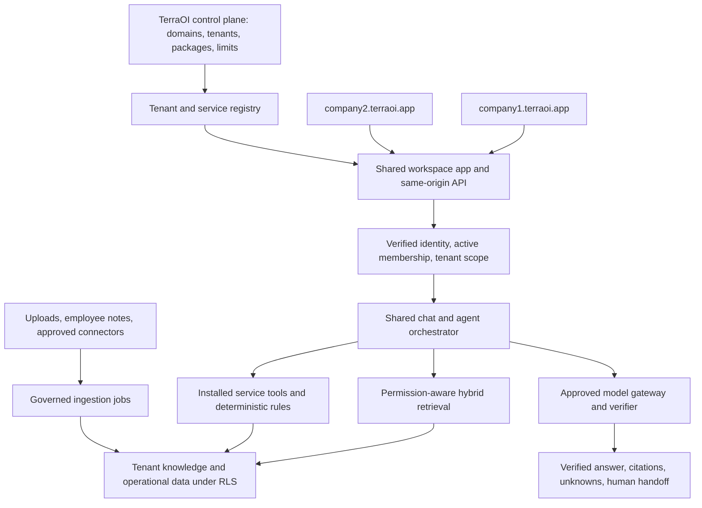

# TerraOI — Multi-tenant Operational Intelligence Platform Plan v1.2

**Updated:** 2026-11-04  
**Company and platform:** TerraOI · **Primary domain:** `terraoi.app`  
**Tenant workspace pattern:** `company1.terraoi.app`, `company2.terraoi.app`  
**Status:** proposed architecture and delivery specification; no application implementation or deployment is claimed  
**Previous plans:** [v1.1](TerraOI-plan-v1.1.md) · [v1](TerraOI-plan-v1.md)

## 0. Executive architecture decision

TerraOI is a white-label platform for business operational intelligence. Each customer company receives its own subdomain, brand configuration, employees, service catalogue, knowledge collections, operational records and expert agents. Company1 is the reference geotechnical tenant, initially offering Drone/UAV and GPR services. It is an example customer of TerraOI, not the platform's identity.

Build **one shared platform with tenant isolation, one reusable RAG and agent runtime, and versioned service packages**. A Drone Expert and a GPR Expert are distinct configured specialists with their own approved knowledge, tools, rules and evaluations; they do not require separate applications, separately trained foundation models, or a database per agent. A future service installs another package on the same platform.

The core product loop is: **employees contribute information → TerraOI processes and governs it → authorized experts retrieve it → employees receive cited answers and controlled operational assistance → reviewed feedback improves the knowledge base**. Continuous ingestion changes the retrieved knowledge, not the foundation model's weights. Raw chat messages do not automatically become company truth.

The first production increment includes tenant provisioning and subdomains, white-label login/workspace, permission-aware uploads and search, a common chat interface, and Drone/GPR knowledge specialists for Company1. Drone operational readiness is enabled only after its record-truth and regulatory prerequisites pass. GPR can answer approved-document questions before its full operational registry exists; it must explicitly report unavailable record tools.

### 0.1 Evidence, authority and scope

- **Confirmed user requirements:** TerraOI owns `terraoi.app`; customer workspaces use company subdomains; white-label capability; extensible business services; a specialist per service; continuously updated company knowledge; employee reuse through agent chat.
- **Observed locally:** the v1/v1.1 plans and a TerraOI brand kit are available. The application checkout, migrations, dependency lockfile and live cloud configuration are absent from this workspace.
- **Reported, not re-verified:** v1's existing UAV features, 694 tests, migration state, exposed database credential, regulatory findings and deployment readiness. Verify them in the application repository before implementation.
- **Proposed in v1.2:** the schemas, interfaces, policies, targets and sequence below. Code samples describe the intended contracts; they are not tested application code.
- **Documentation evidence:** framework and infrastructure references were retrieved from official sources for this revision. Platform-specific behavior is cited near the relevant decision. No live inspection or provisioning of `terraoi.app` was performed.

This revision supersedes the prior UAV-only product framing, deferred tenant subdomains and global UAV role assumptions. It retains v1.1's evidence discipline, database verification, provider controls, human approval and recovery requirements. Existing decision/task IDs are preserved as historical implementation references; record new platform decisions in the application repository before code changes.

### 0.2 Navigation

Read §1 for the section-by-section v1.1 review; §2–§7 for tenancy and extensibility; §8–§9 for ingestion/RAG; §10–§12 for chat and agents; §13–§15 for Company1 and legacy migration; §16–§20 for security, verification, operations and rollout; and §21–§24 for implementation structure, decisions, sources and acceptance.

## 1. Section-by-section review of v1.1

Each existing section/function is retained, generalized or replaced explicitly. This is the analysis trail for the revised architecture.

| v1.1 section/function | Assessment | v1.2 treatment |
|---|---|---|
| §0 Read this first / authority | Useful execution focus; assumes a UAV product | Reframe around TerraOI and company workspaces; retain evidence labels and release gates (§0, §20) |
| §1 Product scope and architecture | UAV rules are mixed with platform rules | Separate platform kernel, business service packages and tenant configuration (§2, §6) |
| §2 Current-state evidence | Correctly distinguishes reported and observed | Retain; remove stale counts from release acceptance; add domain, membership and ingestion evidence (§0.1, §19) |
| §3 Immediate sequence / ownership | Good prerequisites; no tenant bootstrapping | Add domain provisioning, memberships, service installation and knowledge ownership (§4, §20, §22) |
| §4 Release gates | Protects deployment but is UAV-centric | Add platform tenancy/knowledge gates; C0 and citation requirements apply to Drone operational answers (§20) |
| §5 Pilot and outcomes | One readiness flow cannot prove a reusable platform | Pilot Company1 Drone/GPR knowledge; use a synthetic Company2 to prove isolation and different installed services (§20) |
| §6.1 Database verification | Essential and retained | Add subdomain mismatch, multi-membership, source ACL, unpublished-version and service-installation tests (§17) |
| §6.2 Corpus source access | Strong source inheritance; little collection/service structure | Introduce collections, resource ACLs, service mounts and library subscriptions (§7, §9) |
| §6.3 Source version/time | Required for reproducible answers | Add publication pointers, generation manifests, revocation and deletion propagation (§8) |
| §7.1 Search RPC | Sound text/vector inputs; needs tenant/service context | Explicit request scope, authorized collection intersection, model identity and historical validity (§9) |
| §7.2 Record tools | Good audited read-only contract | Version tools in service packages; bind them to tenant, membership, project and capability (§6, §12) |
| §7.3 Deferred processing | Correctly avoids forwarding user sessions | Separate scheduled connector jobs from delegated user jobs; use scoped job capabilities (§8, §12) |
| §8.1 Provider data rules | Retained | Apply to ingestion, embedding, reranking, chat, verifier, tracing and fallback (§16) |
| §8.2 Budget reservations | Retained | Charge tenant/service/project ledgers; separate ingestion from interactive quotas (§18) |
| §9 Answer validation | Retained | Use risk-specific verification; never stream unchecked operational claims (§11) |
| §10 Testing / done | Strong base; lacks multi-service product tests | Add tenant onboarding, continuous ingestion, expert selection, chat persistence and new-service installation (§17) |
| §11 Staging / recovery | Retained | Add DNS/TLS/host-only sessions, per-environment tenant registry and knowledge rollback (§19) |
| §12 Operations / rollout | Retained | Add connector lag, ACL-sync lag, publication freshness and per-tenant fairness (§18) |
| §13 Dependencies / later roadmap | GPR is treated mainly as a distant expansion | Enable a GPR knowledge expert alongside Drone; gate GPR record/QC tools separately (§13, §20) |
| §14 Decisions / maintenance | Retained | Add tenant residency, identity migration, service ownership and knowledge approval decisions (§22) |

**Scope correction:** an expert's existence, its knowledge access and its operational tools are separate capabilities. This permits useful GPR document reuse without pretending that unbuilt GPR operational records exist. It also prevents Drone compliance defects from blocking unrelated approved-document search across the platform.

## 2. Product model and company workspaces

| Concept | Definition | Company1 example |
|---|---|---|
| Platform | TerraOI's shared software and control plane | `terraoi.app` |
| Tenant / organization | Customer security, configuration and commercial boundary | Company1 Geotechnical |
| Workspace domain | Registered entry point mapped to a stable tenant UUID | `company1.terraoi.app` |
| Service package | Versioned functional module maintained by TerraOI | `drone`, `gpr`; later `geotechnical-lab` |
| Service installation | A tenant's enabled package version, settings and entitlements | Company1 installs Drone and GPR |
| Expert definition | Package-owned instructions, tools, retrieval defaults and evaluation policy | Drone Expert v1; GPR Expert v1 |
| Expert instance | Tenant configuration of an installed expert | Company1 GPR Expert with its own approved manuals |
| Knowledge collection | Governed set of sources with ACL and lifecycle rules | Company policies, Drone SOPs, GPR manuals, Project A records |
| Operational records | Structured, authoritative business state | Pilot recency, equipment calibration, QC release state |
| Project | Optional scope within one tenant and relevant services | Site A survey using both Drone and GPR |

An employee signs in at the company subdomain and sees only installed services and authorized data. A home assistant can route questions to permitted experts. Employees may select an expert directly; the visible selection remains until they explicitly change it or approve a suggested route.

TerraOI's platform administrator manages tenant lifecycle, packages, limits and non-content health. A platform administrator has no default permission to read company documents, chats, operational records or embeddings. Any future support access needs tenant-authorized, time-limited, audited delegation.

## 3. System framework and deployment boundaries

### 3.1 Recommended baseline

| Layer | Recommendation | Architectural reason |
|---|---|---|
| Web application | Next.js App Router + React + TypeScript; retain existing Tailwind/component system | Reuse reported investment; serve company workspace and server API from one codebase |
| Chat UI/transport | AI SDK React `useChat` + same-origin `DefaultChatTransport`; typed message parts | Common chat behavior, status, citations and validated answer cards |
| Agent runtime | TerraOI TypeScript orchestration with explicit steps and registered tools | Bound behavior and audit; avoid an unbounded autonomous loop |
| Identity/data | Supabase Auth + Postgres + RLS + private Storage | One authorization model for operational records and retrieval |
| Retrieval | Postgres full-text search + pgvector, RRF and optional permitted reranker | Keep tenant/source authorization near data; measure before adding a search service |
| Web compute | Cloudflare Workers via OpenNext, conditional on compatibility testing | Existing target preserved; domain and API behavior must be proven |
| Background jobs | Queue consumers and durable job state; workflows for multi-stage/retry coordination when needed | Document processing survives web-request timeouts |
| Heavy parsing | Isolated container worker or approved document-processing service when inputs exceed Worker limits | OCR/large PDFs/archives/raw GPR processing need different resource budgets |
| Observability | OpenTelemetry-compatible traces plus app audit/event tables with redaction | Link uploads, ingestion generations, retrieval, tools and responses |
| Validation | Shared versioned schemas for external APIs, manifests, tool arguments and AI output | Explicit contracts at platform boundaries; retain existing domain validators |

Do not adopt a second agent framework or external vector database for the first release. Introduce a graph framework only if measured workflow complexity justifies it, behind the same tool/auth/audit contracts. Exact package versions, runtime support and resource limits must be validated against the application lockfile and current vendor documentation. OpenNext documents the adapter path for Next.js on Workers; this is deployment support, not proof that this application's complete dependency graph works. [OpenNext documentation](https://opennext.js.org/cloudflare)

### 3.2 Control plane and tenant data plane



Start with a modular monolith plus background workers. Separate deployment units for ingestion and control-plane APIs may share a repository, but use different credentials and grants. Tenant content access is never implied by a control-plane role.

## 4. Subdomains, provisioning and white-label behavior

### 4.1 Host contract

| Host | Purpose | Data/session rule |
|---|---|---|
| `terraoi.app` / `www.terraoi.app` | TerraOI public website | No implicit tenant |
| `admin.terraoi.app` | Platform control plane | Separate host-only session and platform privileges |
| `company1.terraoi.app` | Company1 workspace, login, chat and APIs | Resolve registered tenant; authorize membership |
| `company2.terraoi.app` | Another customer workspace | Same software; different tenant context |
| Unknown/unregistered subdomain | Unavailable workspace | Generic unavailable page; no tenant auto-creation |

Keep these as proposed host assignments until DNS/ownership is verified. Reserve names including `www`, `admin`, `api`, `auth`, `status`, `support`, `mail`, `assets`, `staging` and `preview`. Accept one normalized ASCII label for customer slugs; reject nested names, suffix tricks and reserved labels. Persist the full canonical hostname in `tenant_domains` with a unique constraint and immutable tenant UUID. A slug rename changes a domain mapping, not row ownership or storage paths. Do not immediately recycle retired customer hostnames.

**Initial deployment choice:** provision an exact Cloudflare Worker Custom Domain for each approved tenant hostname through the control-plane provisioning workflow. The official Custom Domains facility requires exact hostname matches and does not accept wildcard domains. For later scale, evaluate proxied wildcard DNS plus a Worker Route such as `https://*.terraoi.app/*`, with explicit apex/reserved-host handling and validated TLS coverage. DNS, route matching, certificate coverage and the application tenant registry are separate checks; a wildcard DNS record is not tenant authorization. [Custom Domains](https://developers.cloudflare.com/workers/configuration/routing/custom-domains/), [Worker Routes](https://developers.cloudflare.com/workers/configuration/routing/routes/)

Reject untrusted `X-Forwarded-Host`/tenant headers; only use deployment-verified host information. The server repeats tenant resolution for every API/action, including routes that bypass the page proxy. Protect the default Worker/preview origins so they cannot become alternate production tenant endpoints.

### 4.2 Provisioning workflow

`requested → validating → provisioning → ready → suspended → offboarding → retired`; failures retain a retryable step and error record.

1. Platform admin supplies company name, slug, region, first admin, service installations and initial provider/knowledge policies.
2. Reserve slug/domain and create organization in `provisioning`; enforce uniqueness and idempotency.
3. Create exact host binding, verify DNS/TLS and HTTPS response, configure an exact auth callback, and store provisioning evidence.
4. Create default tenant settings, role templates, service installations, expert instances and empty collections. Do not copy another tenant's data.
5. Issue an expiring invite linked to the tenant and intended role; email-domain similarity alone does not grant membership.
6. Apply brand assets, validate access with synthetic checks, activate the tenant, and record the owner and limits.

Provisioning performs compensating cleanup on partial failure; it must not leave a ready tenant with a missing domain, unprotected callback or unintended service. Suspension blocks new logins, calls and jobs while preserving authorized recovery/export procedures.

### 4.3 White-label contract

Store `tenant_branding`: display/legal name, approved logo variants, accent tokens, accessible foreground pairings, support contact, locale/timezone, report identity, login copy, and sender configuration. Reuse the reported `branding.ts` choke point after inspection; keep hex validation and sanitize or rasterize tenant SVG uploads. Tenant configuration cannot contain executable HTML, JavaScript, CSS or arbitrary remote font URLs.

Apply branding consistently to login/invite/reset, workspace navigation, chat, citations, exports, printable reports and tenant-specific manifest/icon responses. A PWA manifest must have a tenant-bound identity/start URL; service-worker caches and local queues must include tenant and user scope and clear on logout/tenant change. Do not cache private answers as a shared offline shell. A tenant's custom mail sender requires verification; until then use an honest TerraOI sender with tenant display context.

Use public caching only for sanitized brand metadata with hostname, tenant and brand-version keys. All private pages, messages, source views and session-refresh responses default to private/no-store. A theme change must not reveal or reuse another tenant's rendered HTML.

## 5. Identity, tenant context and authorization

### 5.1 Membership model

Separate global `profiles` from `organisation_memberships`. A person may be a member of more than one organization; authorization is evaluated against the active hostname's organization, never a globally mutable selected-company field. Each browser tab keeps its own host context.

Suggested role templates are tenant admin, service manager, employee, reviewer/auditor and read-only. Templates map to permission capabilities and may be customized within tenant policy. UAV role names such as `uav_lead` remain Drone package vocabulary; they must not determine every future service's permissions.

Effective authorization is the intersection of **active identity + active tenant/membership + installed/enabled service + permission capability + resource/project ACL + applicable data policy**. An entitlement enables a feature; it does not grant content access.

### 5.2 Request context contract

```text
TenantRequestContext {
  organisationId, canonicalHost, userId, membershipId,
  membershipRevision, policyRevision, installedServiceVersions,
  permittedCapabilities, requestId
}
```

Construct this context server-side for every request after verifying the Supabase identity and current active membership. Do not accept organization IDs, user IDs, tool permissions, system prompts or provider choices as authority from the browser. Supabase recommends verified identity methods such as `getClaims`, with `getUser` when a current Auth-server user record is required; cached session contents alone are not authorization evidence. TerraOI additionally checks current membership and revocation state in its own database. [Supabase SSR authentication](https://supabase.com/docs/guides/auth/server-side/creating-a-client)

For the target multi-membership model, a request-scoped database tenant selector must be paired with membership checks. Proposed adapter: a server-created Supabase client forwards the caller's JWT and an organization selector to every request; SQL reads the selector with a narrowly defined helper. The selector is **untrusted input**, not an authentication claim. RLS must require all of:

```text
row.organisation_id = requested_org_id()
AND active_membership(auth.uid(), row.organisation_id)
AND resource_permission(auth.uid(), row.organisation_id, row.resource_id)
```

Missing/invalid context returns no tenant rows. Forging a selector for a tenant without membership grants nothing. SQL cannot infer the browser hostname: the application binds host to selector, while database membership/resource policies independently prevent unauthorized access. A user intentionally authorized in two companies may select either via its approved workspace; a request/answer must never mix them.

This is an explicit evolution of v1's single-organization `current_org_id()` rule, not an instruction to add ad hoc filters everywhere. Validate request-header transport against the deployed Data API, test direct RPC/REST access, and replace the legacy helper through an additive migration. If the transport contract cannot be proven, keep the current single-organization model and block multi-membership rollout until a scoped database interface is implemented. Never substitute a service-role client for ordinary user queries.

Postgres grants and RLS both matter; service credentials bypass RLS and require a separate narrowly scoped authorization path. Use composite organization foreign keys, safe function search paths and explicit grants. [Supabase RLS](https://supabase.com/docs/guides/database/postgres/row-level-security)

### 5.3 Sessions, callbacks and CSRF

Use host-only secure sessions per tenant, with no parent-domain cookie shared across all customer subdomains. Where compatible with the tested session adapter, use `__Host-` names, `Secure`, `Path=/`, no `Domain`, and server-only/HttpOnly token storage. If retaining browser-side Supabase auth requires readable cookies, document that tradeoff and test refresh/XSS controls; do not claim HttpOnly while using a browser SDK that needs to read the tokens. Cookies without `Domain` are host-only; `__Host-` adds explicit host/path restrictions. [MDN cookie reference](https://developer.mozilla.org/en-US/docs/Web/HTTP/Reference/Headers/Set-Cookie)

The initial login flow runs at each tenant hostname. Register exact invite/reset/OAuth callback URLs, preserve PKCE/state, bind state to tenant and an allow-listed local return path, and reject cross-tenant or open redirects. A future central SSO flow must use a short-lived one-time exchange, not a domain-wide session cookie. Callback allow-list configuration supports the redirect flow but does not replace application validation. [Supabase redirect URLs](https://supabase.com/docs/guides/auth/redirect-urls)

For mutating APIs and billed chat requests, verify exact `Origin` against the resolved tenant origin and apply a tested CSRF mechanism. Sibling subdomains are not made safe by SameSite alone. CORS does not authorize tenant access. Re-check membership on reconnect, source opening, stored-history reads and draft confirmation.

## 6. Extensible service packages and expert instances

### 6.1 Service package contract

Each service is a trusted versioned code/config package maintained by TerraOI. Tenant administrators configure an installation; they cannot upload arbitrary server code, SQL, tool endpoints or system-level instructions.

```yaml
service_key: gpr
package_version: 1.0.0
capabilities: [knowledge.search, equipment.read, qc.read, draft.propose]
expert:
  key: gpr-expert
  instruction_version: gpr-instructions-v1
  retrieval_profile: gpr-hybrid-v1
  permitted_source_classes: [vendor_manual, company_procedure, project_record]
  read_tools: [gpr.equipment_state, gpr.dataset_lineage, gpr.qc_status]
  evaluation_suite: gpr-golden-v1
  high_risk_topics: [buried_utility_clearance, deliverable_release]
ui_routes: [/services/gpr, /services/gpr/knowledge]
```

This manifest illustrates the schema, not an installed package. Tools are available only when their migrations, backing records, permission mappings and tests are deployed. A knowledge-only installation exposes no unavailable tool as a working capability. High-risk topics require reviewed domain policy and an explicit human handoff; a specialist cannot infer clearance from a generic manual.

An expert instance binds `organisation_id + service_installation_id + expert_definition_version + approved_collection_mounts + permitted_tool_subset + tenant_policy`. Tenant instructions may refine terminology and style inside a bounded configuration field; they cannot relax source ACL, model data rules, verification or action approval.

### 6.2 Shared and service-specific knowledge

- **Company core:** company-wide policies and reusable practices, where the employee is authorized.
- **Service collections:** Drone SOPs, GPR manuals, training, technical procedures and approved lessons learned.
- **Project collections:** client specifications, site records and deliverables, restricted to project access.
- **Personal/session attachments:** private to the uploader/conversation unless explicitly promoted.
- **TerraOI public reference library:** curated public material explicitly mounted by the tenant/service; no customer document is auto-promoted into it.

Experts share the retrieval engine, not an unrestricted knowledge pool. A mixed-service question creates separate authorized retrieval/tool contexts for each specialist and produces one labeled answer. The router may only choose installed, permitted services. For an ambiguous question it asks the employee to choose; it cannot query every tenant or bypass a restricted service to obtain similar information.

### 6.3 Adding a future service

1. Register a unique service key and versioned package manifest.
2. Add only the necessary typed operational tables, capabilities, tools and UI routes; keep shared identity, documents, chat and jobs in the platform kernel.
3. Define source classes, retrieval profile, reviewers, risk policy and a service evaluation set.
4. Apply additive migrations and least-privilege defaults, test isolation, and install for a synthetic tenant.
5. Enable the package for a chosen company without rebuilding that company's own application or changing the common chat endpoint.
6. Record upgrade/rollback compatibility. Disabling a service blocks its tools and expert immediately but preserves data according to export/retention policy.

This is configuration-led extensibility supported by reviewed code. Avoid a generic entity/value database for all operational facts; safety-critical and commercial workflows need typed constraints. A full knowledge graph is deferred until a measured relationship/query need justifies it.

## 7. Proposed data model and schema boundaries

Reuse existing `organisations` and stable tenant IDs after inspection. The following are logical target groups, not a claim that these tables exist or a requirement to create every table before the first vertical slice.

| Group | Proposed entities | Key constraints |
|---|---|---|
| Identity/tenancy | `organisations`, `profiles`, `organisation_memberships`, `tenant_domains`, `tenant_branding` | Unique canonical host; unique org/user membership; activation/revocation revisions |
| Permissions | `capabilities`, `tenant_role_templates`, `membership_roles`, `resource_acl`, `project_memberships` | Platform role separate from content permissions; explicit deny/revocation semantics |
| Services | `service_definitions`, `service_versions`, `tenant_service_installations`, `expert_definitions`, `tenant_expert_instances` | Installation/version/tenant consistency; allowed capability/tool subset |
| Knowledge sources | `knowledge_collections`, `knowledge_sources`, `source_versions`, `source_collection_links` | Tenant-owned sources have non-null organization; immutable version/hash; source owner and review state |
| Retrieval | `knowledge_chunks`, `chunk_embeddings`, `index_generations`, `published_source_versions` | Chunk belongs to immutable source version; model identity/dimensions; atomic published-generation pointer |
| Public library | `library_sources`, `library_versions`, `library_chunks`, `tenant_library_mounts` | Separate controlled public catalogue; explicit tenant/service mount and version policy |
| Ingestion | `connectors`, `connector_cursors`, `ingestion_jobs`, `ingestion_attempts`, `outbox_events` | Scoped connector credentials; idempotency keys; durable job/lease state and tombstones |
| Conversation | `conversations`, `conversation_participants`, `messages`, `message_evidence` | Tenant-bound owner/participants; service/project scope; monotonic message sequence |
| Agent execution | `agent_runs`, `run_steps`, `tool_invocations`, `answer_claims`, `audit_events` | Actor/org/service/version context; record hashes/freshness; no secrets in payloads |
| Feedback/drafts | `knowledge_submissions`, `review_tasks`, `answer_feedback`, `action_drafts` | Draft versus published truth; provenance; human confirmation and SoD |
| Cost/settings | `tenant_ai_settings`, `usage_ledger`, `budget_reservations`, `provider_policies` | Atomic admission, per-tenant/service limits, approved provider/data classes |
| Domain records | Existing UAV tables; future typed `gpr_*` and other service tables | Tenant-composite foreign keys, service permission checks, operational constraints |

Use non-null `organisation_id` on customer-owned rows and composite `(id, organisation_id)` relationships. Public references live in a separate curated namespace rather than relying on a null organization to mean universally readable. Every derivative retains source-version and tenant provenance; deduplication never creates a content-sharing path across customers.

Model many-to-many collection/service mounts explicitly. A source's own ACL remains mandatory even when a collection or service is broadly visible; conflicting policies resolve conservatively. Add indices for tenant, publication state, source/version, service and project selectors. Limit JSON to configuration/validated payloads; do not hide critical permissions or workflow state in unchecked JSON.

Store private files using stable IDs, such as `<organisation_uuid>/<source_uuid>/<version_uuid>/<object>`. Signed upload/download URLs are short-lived and minted after authorization. Validate uploaded object identity, tenant path, MIME signature, size and checksum server-side before ingestion. No browser receives a storage service key or an unrestricted upload prefix.
