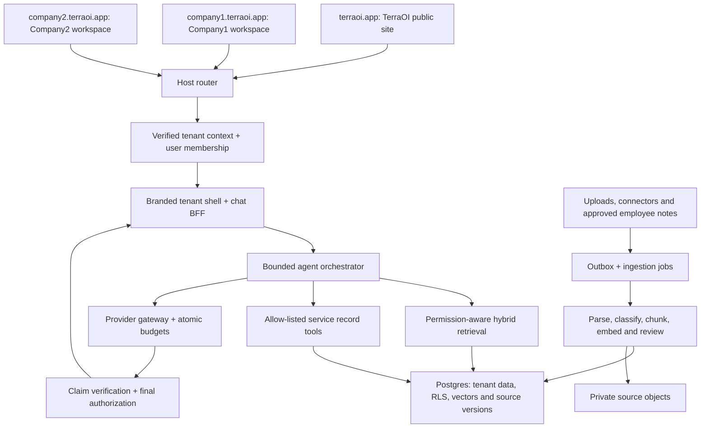
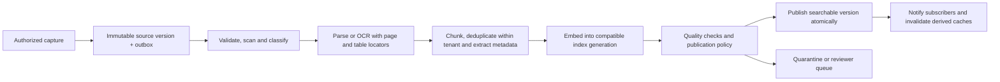

# TerraOI — Multi-Tenant Agentic Operational Intelligence Platform Plan v1.2

**Company/platform:** TerraOI · **Primary domain:** `terraoi.app`  
**Tenant example:** Company1, a geotechnical business at `company1.terraoi.app`  
**Updated:** 2026-11-04 · **Status:** proposed architecture and delivery specification  
**Predecessors:** [v1.1](TerraOI-plan-v1.1.md), [v1 historical inventory](TerraOI-plan-v1.md)

## 0. Executive decision and reading guide

TerraOI is a reusable business operational intelligence platform. A customer company receives a branded workspace on its own subdomain, enables business service modules, connects its information, and gives employees access to expert agents that retrieve authorized knowledge and operational records. Company1's UAV/drone and GPR services are the first example modules; they do not define the limits of the platform.

Build **one shared platform runtime, one tenant-aware knowledge pipeline, and a versioned registry of service experts**. Create an expert configuration per enabled tenant/service, rather than a separate application, model deployment, or vector database for every expert. Add service-specific schemas and tools only where a service needs operational records or actions. A new business can reuse the platform without inheriting aviation terminology, rules, permissions or screens.

The core loop is: **capture information → process and review → publish searchable knowledge → retrieve under employee permissions → explain with evidence → propose or execute an explicitly authorized workflow → capture verified outcomes**. Continuous digestion means this pipeline runs on new and changed information; it does not mean uncontrolled model training or automatic promotion of every conversation into company policy.

**Evidence boundary:** the local workspace contains planning files and a brand kit. Application code and production configuration are absent. No tenants, domains, DNS records, models, connectors, databases or agents have been deployed or tested by creating this plan. Earlier code counts, migration states, tests, regulatory claims, costs and dependency pins remain reported historical information. Architecture decisions below are proposals for implementation; cited documentation supports particular framework capabilities, not proof of TerraOI implementation.

**Authority:** this revision supersedes v1.1's UAV-only product framing, deferred-subdomain assumption, and postponement of all GPR assistance. Its security, evidence and human-decision safeguards are retained and generalized. Existing UAV operational release checks remain necessary before its agent can answer operational readiness questions. Other customers' document-only agents do not depend on aviation-specific C0 or CAR citation tasks.

**Reading paths:** product/sponsor: §§1–3, 15–19; platform/backend: §§3–10, 12–18; chat/frontend: §§4–5, 9–11; knowledge/service owner: §§6–8, 12, 15; v1.1 review: §2. Function-by-function contracts are in §11. Implementation examples are illustrative contracts, not tested application code.

## 1. Product model and scope

### 1.1 Platform, tenant, service, expert and project

| Concept | Meaning | Company1 example |
|---|---|---|
| Platform | TerraOI's shared product, deployment and operating controls | `terraoi.app` |
| Tenant/organization | A business's isolated workspace, branding, memberships, policies and budgets | Company1, `company1.terraoi.app` |
| Service module | A business capability with knowledge taxonomy, permissions, tools and optional operational screens | `uav`, `gpr`; later `geotechnical-lab` or `environmental` |
| Expert agent | A versioned service-specific policy, retrieval plan and tool allow-list instantiated for a tenant | Company1 UAV Expert; Company1 GPR Expert |
| Project/client scope | A narrower information boundary inside a tenant | A client site accessible only to its project team |
| Knowledge collection | An explicitly scoped group of published sources | Company-wide SOPs, GPR manuals, UAV regulations, project records |
| Workflow | A bounded sequence of retrieval, record reads, analysis, review and an allowed action | Explain a readiness refusal or draft a survey QC summary |

Users may eventually belong to multiple tenants, with a separate membership and permissions in each. A tenant is the business isolation boundary; a service is a capability boundary inside it. A subdomain locates a tenant but does not grant access to it.

### 1.2 Platform capabilities versus service add-ons

| Shared TerraOI core | Tenant configuration | Service add-on |
|---|---|---|
| Host resolution, identity, memberships, policy enforcement | Slug, brand, locale, timezone, retention and provider policy | Service labels, navigation and permission areas |
| Uploads, connector jobs, parsing, provenance and publication | Data sources, collection scopes and approvers | Domain parsers, extraction schemas and authority categories |
| RAG retrieval, chat, citations, run audit and budgets | Enabled experts, authorized users, model tier ceilings | Retrieval presets, evaluated prompts and typed read tools |
| Notifications, drafts, approval/action framework | Approvers and separation-of-duties policy | UAV readiness, GPR QC/release, future service rules |
| Usage metering, entitlements, tenant lifecycle and support | Service entitlements and quotas | Domain reports, exports and record schemas |

Self-serve billing and arbitrary third-party plugin execution are later product choices. Entitlements and usage metering are needed from the beginning even if tenant provisioning and invoicing are manual.

### 1.3 Company1 journeys

1. An employee enters `company1.terraoi.app`, sees Company1 branding, signs in and sees only permitted services/projects.
2. The employee selects GPR Expert and uploads an equipment manual into a GPR collection. Processing status and audience are visible. Once the source is published, permitted colleagues can retrieve it without uploading it again.
3. Another employee asks for a setup procedure. The GPR agent returns supported steps with page/section citations and version dates. Missing site conditions are explicit; the agent does not invent a survey conclusion.
4. A UAV lead asks why a pilot/aircraft/operation is blocked. The UAV expert reads current operational tools and relevant published rules. The deterministic readiness result remains authoritative.
5. A manager asks a cross-service question. A bounded coordinator consults only enabled, authorized experts and keeps their evidence and limitations distinguishable. Commercial records remain separately permissioned.
6. A knowledge owner approves a correction or useful field note as a new source version. The ingestion pipeline updates the searchable corpus and marks affected saved answers as requiring revalidation.

## 2. Section-by-section review of v1.1

Each original section and named sub-function has been reviewed below. This is a planning review; individual source-code functions cannot be audited without the application checkout.

| v1.1 section | Assessment and change | v1.2 implementation location |
|---|---|---|
| §0 Read first | UAV-first framing obscured TerraOI's product boundary. Replace with shared platform and customer/service hierarchy; retain evidence labels. | §§0–1, 19 |
| §1 Product/architecture | Keep modular app, Postgres RLS and deterministic domain engines. Move UAV/GPR under service modules; make subdomains and white-label core requirements. | §§3–6 |
| §2 Evidence register | Keep observed/reported/planned/unverified labels. Do not repeat unverifiable branch/test counts as current facts. Add domain, connector and corpus evidence. | §§17, 19 |
| §3 Sequence/ownership | Keep reported-exposure containment and recoverable baseline first. Add tenancy and knowledge foundations before agents. Assign platform and per-service owners. | §§15–16 |
| §4 Release gates | Keep evidence-based gates. Split universal platform acceptance from per-service record truth; UAV C0 cannot block unrelated services. | §15 |
| §5 Pilot/outcomes | Keep a small pilot. Include reusable document assistance for UAV and GPR; expand UAV operational answers only after its domain gate. Measure successful employee knowledge reuse. | §§1.3, 15 |
| §6.1 Database verification | Keep migration/RLS/constraint tests. Add tenant domains, multi-membership, service/project boundaries and transaction-local context. | §§4, 6, 16 |
| §6.2 Source access | Keep inherited ACLs across chunks/history/audit. Add connector ACL synchronization, publication status and agent collection scopes. | §§6–8, 12 |
| §6.3 Source time | Keep immutable versions and effective intervals. Add source change detection, ingestion/index generations, revocation and citation revalidation. | §§7–8 |
| §7.1 Search RPC | Keep query vector/model identity and error distinctions. Add tenant/service/project/collection scope, index generation, deterministic citation lookup and ACL-aware cache keys. | §§8, 11 |
| §7.2 Tools | Keep typed, capped, read-only defaults. Register tools through service manifests and separate read, draft and approved action capabilities. | §§5, 10–11 |
| §7.3 Queues | Deferred chat work can remain optional. Continuous ingestion needs durable background work from the start; use scoped jobs/outbox/idempotency. | §§7, 10, 13 |
| §8.1 Provider rules | Keep per-tenant data policy. Apply it to parsing/OCR, embedding, reranking, composition, verification and caches. | §12 |
| §8.2 Budgets | Keep atomic reservations. Include ingestion, connector backfills and proactive agents, with per-tenant fairness. | §§12–13 |
| §9 Answer validation | Keep separate binding and semantic checks. Resolve the streaming conflict: show progress first; publish factual content only after validation. | §§9–10, 16 |
| §10 Testing/DoD | Keep DB/browser/AI checks. Add sibling-subdomain attacks, branding surfaces, source changes/deletes, service installation and cache isolation. | §16 |
| §11 Deployment/recovery | Keep isolated staging and restore evidence. Add wildcard routing/TLS, tenant provisioning, callback origins, ingest/index rollback and tenant suspension. | §§4, 13, 17 |
| §12 Operations/rollout | Keep audit/alerts/kill switches. Add freshness lag, source sync status, connector ACL failures and per-expert effectiveness. | §§13, 17 |
| §13 Tasks/roadmap | Preserve old task IDs as legacy references. Introduce platform workstreams with explicit dependencies; GPR knowledge can precede GPR operational schemas. | §15 |
| §14 Decisions/maintenance | Keep accountable owners and source verification. Replace scattered status with decision, contract and evidence registers; record changed decisions explicitly. | §§18–19 |

## 3. Framework and system architecture

### 3.1 Recommended framework baseline

Use a **modular monolith with background workers**, sharing domain contracts. This keeps tenancy, knowledge and agent governance consistent while allowing ingestion to scale separately from interactive chat. Defer microservices and per-tenant forks until measured load, residency or contractual isolation requires them.

| Layer | Recommendation and reason | Boundary |
|---|---|---|
| Application | Next.js App Router + React + TypeScript; retain the existing component approach | Tenant BFF, pages, chat API, admin and domain screens |
| UI/stream adapter | AI SDK React `useChat` with a same-origin transport; typed UI messages | Transport/UI only; not authorization or the entire agent architecture |
| Validation | Zod or equivalent runtime schemas at new platform boundaries | Requests, manifests, job payloads, tool results, answer contracts; do not force unrelated validator rewrites |
| Database | Supabase-managed Postgres, RLS, composite FKs, SQL migrations, generated types | Tenant records, permissions, source metadata, search, run/audit and budget ledger |
| Retrieval | pgvector + Postgres full-text search, RRF, optional reranking | One permission-aware retrieval service; no per-agent vector database |
| Web compute | Cloudflare Workers through OpenNext, subject to compatibility tests | Request handling; avoid heavy parsers in the web isolate |
| Background work | Cloudflare Queues for dispatch, Postgres job/outbox state; Workflows only for durable multi-step orchestration when justified | Ingestion, retries, change propagation and bounded proactive work |
| Parsing | Bounded worker adapter; heavier OCR/PDF/office processing in a suitable isolated execution service | Same tenant data policy; processor selection is a deployment decision |
| Objects | Supabase private Storage initially; R2 adapter for large raw survey datasets when needed | Object ACLs checked through platform APIs, short-lived signed URLs |
| Models | Provider-neutral gateway by task class | Approved routes per tenant/data class; reproducible embedding identity |
| Secrets | Platform-managed runtime secrets with per-connector references | No model/service keys in the browser or expert manifests |

Do not copy v1's exact package versions, model names, vector dimensions, subscription costs or memory assumptions into a new build. Pin a tested framework/adapter/SDK compatibility set after inspecting the real checkout. The adapter documents a production-like Workers preview; run it in addition to normal development and test actual staging for resource limits. [OpenNext setup and preview](https://opennext.js.org/cloudflare/get-started).

### 3.2 Components and trust boundaries



The public website is not a default tenant. TerraOI's control plane manages tenant configuration and fleet health; tenant data planes serve customer operations. A platform administrator does not automatically receive customer document or chat access. Any future support access is a time-limited, tenant-approved, audited entitlement.

### 3.3 Proposed source layout

```text
src/
  app/                         # public/control-plane/tenant route groups and APIs
  platform/
    tenancy/ identity/ policy/ branding/ services/
    knowledge/ retrieval/ agents/ chat/ approvals/
    connectors/ budgets/ audit/ notifications/
  modules/
    uav/                       # deterministic engines, records, tools and reports
    gpr/                       # calibration, lineage, QC and commercial adapters
  components/
    tenant-shell/ chat/ citations/ knowledge/ approvals/
  contracts/                   # runtime schemas shared with workers
workers/
  ingestion/ sync/ dispatcher/ scheduled/
supabase/migrations/
docs/
  architecture/ contracts/ decisions/ status/ runbooks/
```

This is a target boundary map, not an instruction to move existing files before tests protect them. Extract shared platform behavior incrementally; keep working UAV engines intact.

### 3.4 Existing portal migration, one subsystem at a time

The v1 repository is a potential starting implementation, not proof that the platform already exists. Inventory and preserve behavior before extracting it. The following compatibility work must be represented in migration tasks:

| Existing subsystem reported in v1 | Preserve | Required platform change |
|---|---|---|
| `current_org_id()`, profile organization and permission helpers | Database-enforced tenancy and active-user checks | Backfill memberships; add transaction-scoped request context; audit all helper callers before removing singleton assumptions |
| `front_door_org_id()` and public processing-task intake | Anonymous abuse controls, data minimization and non-forgeable organization assignment | Resolve intake tenant from its verified host; issue a short-lived signed intake context bound to host, org and form type; a narrow server/DB write path validates it rather than trusting a posted org; keep apex marketing counts separate |
| Global site-origin/callback helpers | Redirect validation and safe invitation/reset flows | Exact tenant canonical origin from domain registry; test expired invites, aliases and suspended tenants |
| `branding.ts` and organization settings | Central validation/choke point | Expand to the full `TenantBrand` contract and all customer-visible surfaces; preserve kit mode rules |
| Deterministic readiness/credential/declaration engines | Pure business rules, separation of duties and meaningful existing tests | Encapsulate in UAV module; complete C0/citation corrections before operational tools use them |
| Report/CSV catalogue and capped exports | Area checks, truncation notices and formula-injection protection | Tenant brand/source permissions; service registration; project-scoped exports and metadata checks |
| API keys and outbound webhooks | Hashed keys, narrow scopes, signed delivery and SSRF controls | Bind org/service/project scopes; recheck tenant lifecycle; add limits, audit and per-tenant delivery budgets |
| Storage paths and signed downloads | Private buckets, bounded URLs and path validation | Common source/object authorization contract; branded assets isolated from private document downloads |
| Weekly reminders and notifications | Deduplication, partial-failure visibility and scoped scans | Run explicit tenant/service jobs; expand domain coverage separately; avoid dual schedulers during host cutover |
| Offline capture and browser queues | Safe offline workflow where needed | Partition by tenant/principal and record version; reauthorize replay; no default offline document/chat cache |
| SharePoint mirror | Reviewed exclusions and original record ownership | Treat export mirroring and knowledge ingestion as separate purposes/grants; do not silently reuse broad mirror credentials for RAG |

Anonymous intake cannot use an employee-session RLS RPC. Its privileged adapter must validate the server-issued scoped grant, allowed fields, host binding, expiry and throttle before setting the organization. Test forged grants, cross-host replay and organization substitutions. Tenant-aware public intake is a later independently accepted surface if not needed for the initial pilot.

## 4. Subdomains, identity and tenant isolation

### 4.1 Domain map and request resolution

| Host | Purpose | Data behavior |
|---|---|---|
| `terraoi.app`, optionally `www.terraoi.app` | TerraOI site, product information and approved entry links | No fallback to Company1 operational data |
| `admin.terraoi.app` | Platform control plane | Provisioning/health; no default domain-data bypass |
| `company1.terraoi.app` | Company1 tenant UI and its same-origin APIs | Company1 context, then employee/service/project permissions |
| `company2.terraoi.app` | Another tenant | Separate memberships, knowledge, branding and usage |
| `company1-staging.terraoi.app` | Proposed explicit staging origin | Separate database, objects, credentials, callbacks and budgets |

Serve first-level tenant subdomains through proxied wildcard DNS and a Worker **Route** such as `*.terraoi.app/*`. Configure apex and reserved hosts explicitly. A Worker Custom Domain is an exact-host mechanism, not wildcard tenant provisioning; use the appropriate DNS/route/TLS combination and test it in staging. Routing documentation also describes specificity rules, so verify collisions with reserved hosts. [Cloudflare Routes](https://developers.cloudflare.com/workers/configuration/routing/routes/), [Custom Domains](https://developers.cloudflare.com/workers/configuration/routing/custom-domains/).

On **every** page, API, upload, download, SSE/polling and action request:

1. Normalize and validate the externally routed hostname through the trusted deployment adapter. Reject malformed hosts, unexpected ports, additional subdomain levels and unrecognized domains. Development exceptions are explicit and environment-bound.
2. Resolve an active, exact hostname in `tenant_domains`; do not infer access from a suffix, request body, query string or model-produced tenant ID.
3. Classify reserved public/control-plane hosts before tenant routing. Unknown/suspended tenants get a generic failure, never Company1 branding or data.
4. Validate the user session, active membership, tenant state and required service entitlement/permission. Derive one immutable `TenantContext` for the request.
5. Pass that context to scoped data access and tools. Strip/overwrite inbound internal tenant headers; route handlers independently establish context rather than trusting a client-supplied header or only the page proxy.
6. Use the same host resolver for canonical URLs, callback allow-lists, email links, assets and signed-object actions. Do not retain a single global `NEXT_PUBLIC_SITE_URL` as the tenant URL authority.

Prevent access through deployment preview aliases or `workers.dev` origins from bypassing host checks. A slug rename is a controlled domain transition; retained aliases are explicit, and deleted tenant slugs are not immediately reassigned.

### 4.2 Session model and multi-membership

**Initial decision:** use a server BFF for browser data access. Tenant browser requests stay on the tenant origin; the BFF uses a verified Supabase user session for user-scoped database operations. Do not ship privileged keys or a general direct-data client to chat UI code.

Use host-only Secure, HttpOnly session cookies without `Domain=.terraoi.app`; use the `__Host-` prefix where the selected auth adapter supports its requirements. Separate host sessions avoid an accidental shared-cookie boundary across companies. SameSite alone is insufficient protection against sibling subdomains; require exact `Origin` validation and CSRF protection for state-changing endpoints. Use explicit HTTPS tenant callback URLs and invitation binding; do not use broad wildcard auth redirects or URL-carried session tokens. Cookie prefix and Domain behavior are documented in [MDN Set-Cookie](https://developer.mozilla.org/en-US/docs/Web/HTTP/Reference/Headers/Set-Cookie).

Employees can be members of more than one tenant. Resolve membership from current database state. Do not mutate a user-wide `profiles.organisation_id` when switching tabs/tenants, and do not use a stale unverified JWT claim as the only membership check. Initially require tenant-origin sign-in; central SSO is a later tested one-time handoff/federation design, not a shared parent-domain cookie shortcut.

### 4.3 Database request context

Migrate the reported single-organization helper to an explicit membership-aware context before supporting multi-tenant tabs. Proposed pattern: user-scoped **security-invoker RPCs** receive a server-validated `p_organisation_id`, establish a transaction-local tenant scope, verify active membership using `auth.uid()`, and perform bounded SQL under RLS. The RLS predicate independently requires both membership and the same transaction-local organization. Ordinary tenant operations without a scope fail closed. A custom scope value alone never confers membership.

Set context and execute the operation in the **same RPC transaction**. A previous HTTP RPC's `SET LOCAL` does not carry into a later request. Never place tenant state in a pooled connection's persistent settings or a process-global variable. Helpers used by RLS must avoid recursive policy cycles, have narrow grants and fixed safe search paths where privileged helpers are unavoidable.

This deliberately revises v1's blanket prohibition on application organization scope: trusted adapters now supply the host-resolved organization to scoped RPCs, while RLS and membership checks remain mandatory. Do not retrofit tenant filters throughout UI components. Document every service-role bypass. Supabase explains that service-role access and privileged functions can bypass RLS; they require independent scoping. [Supabase RLS](https://supabase.com/docs/guides/database/postgres/row-level-security).

### 4.4 Cache, storage and browser isolation

Authenticated pages, chat and run results default to private/no-store. Any later cache key includes organization, user or proven permission cohort, ACL revision, service/project scope, corpus generation, query and model/policy version. Reauthorize dependencies before replay; disable a cache that cannot preserve this contract. Public brand configuration is a separate, hostname-keyed cache with bounded invalidation; do not include membership details in it.

Private objects use organization-prefixed keys and composite database references, but a path prefix alone is not authorization. Citation clicks mint new short-lived URLs after source access checks; do not persist signed URLs in answers. Service-worker/IndexedDB queues are partitioned by tenant and authenticated principal and cleared on logout/account change. Sensitive chat/documents are not offline-cached by default.

## 5. White-label and service extension contracts

### 5.1 Branding across the product

Reuse the supplied [white-label guide](TerraOI-Brand-Kit-v1.0.0/05-guides/WHITE-LABEL.md) and [brand configuration](TerraOI-Brand-Kit-v1.0.0/02-system/brand-config.json). The kit defines `terraoi`, `powered` and `customer` modes; production mode is tenant configuration, never an arbitrary public `?brand=` or cross-customer selector.

| Mode | Product presentation |
|---|---|
| `terraoi` | TerraOI identity for platform-owned surfaces |
| `powered` | Customer identity with approved Powered by TerraOI attribution |
| `customer` | Customer identity without visible provider attribution in customer product content |

One `TenantBrand` contract covers display/legal names, descriptor, logo, favicon, primary/on-primary/accent colors, attribution, report owner, email sender name, verified sender/reply-to, document prefix, support links, locale and timezone. Validate colors/assets/URLs; sanitize or reject uploaded SVG/HTML; validate actual contrast. Do not permit arbitrary CSS or scripts. Custom names and instructions are untrusted content.

Apply the contract server-side to login/reset/invitation pages, tenant shell, expert labels, chat empty/error states, browser titles/social metadata, manifest/icon behavior, notifications, printed reports, CSV/PDF/Word metadata, filenames and emails. Sender identity requires a verified sending configuration; a display name does not establish domain authorization. Use a reviewed platform fallback where appropriate and surface it to the tenant admin.

Customer-only presentation cannot hide the provider name in the required `company1.terraoi.app` URL or override necessary legal disclosures. If a customer later requires its own hostname, add verified custom-domain ownership and certificate lifecycle as a separately tested feature. Do not promise it is already available.

### 5.2 Service module and expert definition

A service module supplies a versioned manifest, domain permission areas, optional migrations/screens, parser/extraction adapters, approved collection types, read tools, permitted draft/action types and evaluation cases. Install it through reviewed platform code/configuration; customer-uploaded documents cannot install executable tools.

```ts
// Proposed platform contract; schemas and imports belong in implementation.
type ExpertDefinition = {
  key: string;                 // e.g. 'uav-expert' or 'gpr-expert'
  version: string;
  serviceKey: string;
  instructionTemplateVersion: string;
  retrievalProfileVersion: string;
  collectionBindings: string[]; // resolved and authorized by the server
  toolKeys: string[];          // intersection with tenant + user permissions
  workflowKeys: string[];
  answerSchemaVersion: string;
  evaluationSetVersion: string;
  riskClass: 'knowledge' | 'operational' | 'commercial';
};
```

`tenant_services` enables a service; `tenant_experts` selects approved versions and tenant-owned configuration. Tool availability is the intersection of platform allow-list, service manifest, tenant policy, current user permissions and run budget. Tenant instructions may tune vocabulary and output style, but cannot weaken authorization, source authority or approval requirements.

Expert specialization is a governed retrieval/tool contract over shared infrastructure. Different foundation models are optional and based on measured accuracy, data policy and cost. Domain owners approve prompt/tool/retrieval changes and release their evaluation set with the version.

## 6. Data model and isolation rules

### 6.1 Logical table groups

Names below are proposed; reconcile them with existing tables before writing migrations. Retain `organisation_id` for compatibility rather than introducing a second synonymous `tenant_id` column everywhere.

| Group | Core entities and important fields |
|---|---|
| Tenant lifecycle | `organisations` (status, locale/timezone, policy revisions); `tenant_domains` (unique normalized host, org, status, canonical/alias); `tenant_brands` (mode, validated configuration/version) |
| Identity/access | Global `profiles`; `organisation_memberships` (org, user, status); org-scoped roles/role_permissions; groups/group_memberships; project memberships; policy revisions |
| Services | Platform `service_definitions`, versioned `expert_definitions`/tool metadata; `tenant_services`, `tenant_experts`, collection bindings and entitlements |
| Knowledge ownership | `knowledge_collections` (org/service/project/audience, publication policy); `knowledge_sources` (kind, connector/external ID, owner, current version, deleted/revoked state) |
| Knowledge versions | `source_versions` (org/source/version/hash, object ref, provenance, effective interval, extraction version, review state); `source_acl_bindings` and service/collection associations |
| Retrieval | `knowledge_chunks` (org/version/locator/text/FTS, ACL link); `embedding_indexes` (model/version/dimensions/metric/generation); `chunk_embeddings` associated with the compatible physical index; active published generation pointers |
| Shared public knowledge | Separate approved `reference_sources`, `reference_versions`, `reference_chunks` and compatible reference embeddings; explicit allowed services/jurisdictions/licenses; no tenant-private rows |
| Ingestion/connectors | `connector_instances` (org, secret ref, scope, ACL policy, cursor); `ingestion_jobs`, transactional `outbox_events`, extraction artifacts, sync checkpoints and review queue |
| Employee knowledge capture | `knowledge_submissions` (note/answer/correction, original context, audience, reviewer, state); links to approved published source versions |
| Chat and agent work | `conversations`, `conversation_members`, `messages`, `agent_runs`, `run_steps`, evidence/claim links and authorized output dependencies |
| Workflows | `agent_drafts`, `approval_requests`, `action_executions`, per-action idempotency keys and outcome links |
| Spend and operation | Budget accounts/reservations/entries, usage events, audit events, notifications, source subscriptions and health snapshots |
| Domain data | Existing `uav_*`/pilot/fleet tables; GPR units/calibration/jobs/lines/datasets/processing/QC/commercial tables; future modules own their schemas |

Global catalog tables contain definitions, not customer secrets. Public reference material is physically/logically separate from private tenant sources: no overloaded null organization means public. Shared references are curated only by authorized platform publishing jobs; tenants cannot publish private uploads globally.

### 6.2 Relational invariants

Every tenant-owned row has a non-null organization and indexed tenant references. Use composite foreign keys `(organisation_id, id)` for tenant relationships, including jobs, chunks, projects, conversations, drafts and object metadata. A collection/service association must reference an enabled service in the same organization. A project association must reference a project in that organization. Unique external-source IDs and content identities are tenant-scoped; no cross-tenant deduplication side channel.

The effective read predicate is: **active organization AND active user membership AND request organization matches AND required area/level AND source/project audience AND permitted service AND published version/effective date**. Implement helpers carefully, benchmark them, and apply RLS to both retrieval lanes. Re-check source authorization for derived histories, summaries, caches and audit views. Do not rely on a search-time check to authorize later downloads.

Conversations are private to their creator by default. Explicit sharing is bounded to permitted tenant members; sharing a conversation never grants access to its sources. Store dependency IDs so unauthorized source-derived content can be withheld or safely regenerated. Creating a summary does not remove the source sensitivity.

Budget/audit writers and ingestion jobs use narrow server-owned interfaces. Append-only audit does not mean every tenant admin may read every prompt. Retention/deletion/legal-hold policy is per category and tenant contract; do not automatically apply aviation record retention to all business conversations.

## 7. Continuous document and information digestion

### 7.1 Inputs and authority

Accept approved file uploads, typed notes/corrections, supported connector documents, structured operational events and later licensed web/reference sources. A chat attachment starts as private session evidence. The uploader chooses or is assigned a collection/audience that they can publish into; it does not become company knowledge automatically.

Separate **information readiness** from **authority**. A successfully parsed vendor manual is not company policy, a suggested chat answer is not a verified field fact, and a manufacturer's capability statement is not a regulatory requirement. Service-specific authority taxonomies and reviewers govern what each type can support. Show provisional status clearly.

### 7.2 Processing lifecycle



1. **Capture:** authorize host/user/collection, validate size/type, upload directly to private storage with bounded grants, confirm object identity/hash and create a source-version record. Commit an outbox event in the same transaction as the job state.
2. **Validate:** check actual MIME/file signature, decompression limits, malware policy and parser eligibility. Isolate parsers and quarantine failures; never execute macros or document instructions. Meter storage/page/token limits before expensive processing.
3. **Extract:** preserve page/section/table/figure locators, units and original object references. OCR confidence and parse warnings are metadata. A parser's failure or missing table is visible, not an empty successful source.
4. **Chunk:** use headings and semantic boundaries, preserving table headers and referenced context. Start with configurable token-sized chunks and limited overlap; tune per service using retrieval tests rather than one global character length. Keep stable version-specific chunk IDs.
5. **Classify:** attach service, project, client, language, source authority, sensitivity, effective interval and inherited ACLs. Model suggestions are reviewed where they affect authority, audience or operational truth. Users cannot widen a source's inherited ACL by relabeling it.
6. **Embed:** use the collection/index's exact model version, dimension and normalization contract. Batch with bounded retries and ingestion budgets. Metadata-only ACL changes should not require a text re-embedding, but must immediately change visibility.
7. **Quality/review:** validate complete extraction, source permissions, index compatibility and required metadata. Low-risk internal notes may follow tenant-configured automatic publication; regulated requirements, critical SOPs and operational corrections require a designated reviewer.
8. **Publish:** atomically activate a complete version/generation only after checks. Do not expose half-embedded chunks. Policy identifies whether the prior published version remains usable while replacement is pending; material revocation immediately removes it.
9. **Propagate:** invalidate relevant caches, revalidate saved-answer dependencies, update freshness status and notify permitted subscribers. Notifications disclose no forbidden-source details.

States: `received → validating → extracting → indexing → awaiting_review → published`; alternate states include `quarantined`, `failed`, `superseded`, `revoked`, `deleting`, `deleted`. Store stage timings, retry reason and last successful publication. The employee sees received, processing, needs review, ready or failed—not a claim that upload instantly taught an agent.

### 7.3 Connector changes and ACLs

Start with uploads and approved notes, then one well-scoped connector (for example SharePoint) after verifying its actual integration. Each connector instance belongs to one tenant, has a secret reference, approved collections, source identities, ACL mapping, health and a cursor. Use incremental change tokens/webhooks where supported, plus reconciliation scans; connector capabilities and required permissions must be verified before implementation.

Webhook events are hints; reconcile against the authoritative source before indexing. Establish explicit credential type and audience mapping. Broad app-only read access must not become broad employee access. If source user/group ACLs cannot be mapped reliably, quarantine or restrict the collection to a verified audience.

ACL changes/revocations take priority over indexing new text. If an ACL check is stale or sync fails beyond the collection's permitted window, fail closed for that source or require a live authorization check. Missing files in an incomplete scan are not bulk deletion evidence. Handle deletions/tombstones explicitly and prevent old jobs from republishing deleted versions.

### 7.4 User feedback, reusable knowledge and memory

Give each answer **Useful**, **Incorrect**, **Suggest correction**, and **Save as knowledge** actions. Ratings are evaluation signals, not factual updates. A save creates a submission containing the proposed text, provenance, audience, service/project, author, reviewer and expiry/review date. The employee confirms the audience; a reviewer approves it under collection policy. It then becomes a normal versioned source.

Keep three distinct stores: private conversation context, submitted employee knowledge awaiting publication, and approved reusable knowledge. Conversation summaries inherit source permissions and can become stale; retrieve current evidence when answering. Never let repeated model outputs gain authority by being re-ingested as independent corroborating sources. No tenant data is used to train shared models by default.

### 7.5 Reliability and freshness

Use stage-level idempotency `(org, source, version, stage, parser/index generation)`, job leases, bounded retries, a dead-letter path and a reconciler for stuck/missing jobs. Outbox dispatch and consumer processing tolerate duplicate events. Cloudflare Queues provides at-least-once delivery, so application deduplication is required. [Queue delivery guarantees](https://developers.cloudflare.com/queues/reference/delivery-guarantees/).

Proposed pilot freshness goals: ordinary documents up to 20 MB/100 pages searchable within 5 minutes p95 after acceptance when no manual review/OCR backlog is required; otherwise show stage/queue status. Source revocation should block new retrieval within 60 seconds of a received authoritative change; stricter collections may require live checks. Measure connector discovery delay separately from processing delay. These are design targets to validate, not current service guarantees. Supabase's asynchronous embedding guidance demonstrates the decoupled job pattern; TerraOI's queue choice and approval lifecycle are its own design. [Automatic embeddings](https://supabase.com/docs/guides/ai/automatic-embeddings).

## 8. Efficient, permission-aware RAG retrieval

### 8.1 Read pipeline

1. Resolve the tenant and employee permissions before routing. Present only enabled/permitted experts; the model cannot enumerate hidden services or projects.
2. Validate requested service/project and question size. For Auto mode, route only across the authorized expert set, with bounded clarification when scope is ambiguous.
3. Load the expert's approved collection bindings plus accessible tenant-wide knowledge and allowed public references. Resolve jurisdiction/effective date when relevant. The employee can narrow this scope, never broaden it.
4. Use deterministic lookup first for exact record IDs, document titles, provision numbers and equipment models. Query live tools for current operational state rather than relying on stale embeddings of dynamic records.
5. Generate a query vector using the active compatible index identity. Retrieve bounded candidates from full-text and vector paths under equivalent SQL/RLS filters, then combine by reciprocal-rank fusion.
6. Optionally rerank authorized candidates within the approved processing policy. Preserve version/locator/authority metadata; diversify sources and remove duplicate passages without dropping necessary table context.
7. Apply evidence sufficiency and conflict checks; ask a clarification or refuse if the source coverage/date/authority cannot support the question. Never lower ACLs to fill a result quota.
8. Read capped service tools and build a minimal evidence bundle. Verify token budget and provenance before composing; record retrieval/tool diagnostics without revealing forbidden records.

Supabase documents both hybrid retrieval and RLS-filtered RAG. TerraOI adds service, project, publication and version constraints to those primitives. [Hybrid search](https://supabase.com/docs/guides/ai/hybrid-search), [RAG permissions](https://supabase.com/docs/guides/ai/rag-with-permissions).

### 8.2 Proposed SQL interface

```text
search_corpus_v1(
  p_organisation_id uuid,       -- derived from validated host by BFF
  p_service_keys text[],        -- authorized intersection, not arbitrary routing
  p_project_id uuid | null,
  p_collection_ids uuid[],      -- optional narrowing only
  p_query_text text,
  p_query_embedding vector,
  p_embedding_index_id uuid,    -- server-resolved model/dims/metric/generation
  p_effective_on date | null,
  p_authority_filters text[],
  p_limit integer
) -> authorized evidence rows + bounded coverage diagnostics
```

The invoker RPC establishes the same transaction's organization context and verifies membership, service and collection permissions. Reject incompatible index identities and unauthorized scope; do not silently drop an invalid project and widen the search. Query public references through a distinct approved lane and label them. If multiple compatible corpora/index identities must be searched, produce one query vector per identity; combine ranked results, never compare incompatible vectors directly.

Evidence rows include tenant/reference scope, source/version/chunk IDs, supporting span, page/heading/table locator, authority, effective interval, source hash, index generation and ranking diagnostics. Distinguish `no_accessible_evidence`, `coverage_unknown`, `historical_gap`, `index_unavailable` and `backend_failure`; employee-facing messages must not disclose inaccessible records. A source URL or supplied citation is not accepted without resolving its authorized source/version.

### 8.3 Performance controls

Begin with measured exact/vector search for small corpora and establish an exact-search recall baseline. Use HNSW when volume/latency justify it. Filtered approximate search can under-return; tune iterative scanning and candidate budgets, then compare with exact authorized results. Consider tenant/service partitioning or partial indexes for measured skew, not an index per expert by default. [pgvector filtering and iterative scans](https://github.com/pgvector/pgvector#filtering).

Initial configurable run limits: up to two retrieval passes per service, two selected services for Auto mode, six record tools total, 12 final evidence chunks and bounded source bytes/output tokens. These limits are tunable engineering defaults, not guarantees of sufficient evidence. Require visible truncation and a refusal/clarification path when a cap affects the answer. Use per-tenant fair scheduling so an ingestion backfill does not starve interactive questions.

Use a shadow index generation for embedding model changes, backfill, evaluate recall/ACLs, switch the active pointer atomically and retain the prior generation for rollback within policy. Do not claim a fixed model dimension or database memory floor before corpus/load measurement. Cache only with the scope/revision contract in §4.4.

## 9. Agent chat box: product and implementation

### 9.1 Chat surface

The tenant shell owns persistent navigation, service/project pickers and branding. Chat is a full workspace at `/chat`, with a contextual side panel on service screens. Both use the same backend conversation and answer contracts.

```text
company1.terraoi.app/chat
┌─────────────────────────────────────────────────────────────────────┐
│ Company1 logo    Operational Intelligence       Project: Site A     │
├──────────────┬──────────────────────────────────┬───────────────────┤
│ Services     │ Expert: GPR  [Auto / permitted]  │ Evidence          │
│ • UAV        │                                  │ Manual v3, p.18   │
│ • GPR        │ Employee: Which setup checks ... │ SOP-12, §4        │
│ • Knowledge  │                                  │                   │
│ • Approvals  │ Status: searching / verifying    │ Freshness/version │
│              │ Verified answer + [1] [2]        │ Missing details   │
│ My chats     │ Limitations and next action      │                   │
├──────────────┼──────────────────────────────────┴───────────────────┤
│              │ Ask GPR Expert... [Attach] [Send] [Stop while active] │
└──────────────┴──────────────────────────────────────────────────────┘
```

Chat shows the selected expert/project, data freshness, cited spans, unknowns, review status and the distinction between a proposed draft and a completed action. Citation previews reauthorize access. On mobile, evidence becomes an accessible drawer and navigation collapses; preserve keyboard/screen-reader operation and readable tables.

Only permitted experts/projects appear. Switching tenant resets the chat instance/context; never reuse company1 history on company2. Private conversation list is the default. Explain upload audience before submission. Attachments have received/processing/review/ready states; until ready, the answer cannot pretend they were searched.

### 9.2 Browser-to-server contract

Use same-origin `/api/chat` under each tenant subdomain. Do not connect the browser directly to a model endpoint, vector database, privileged RPC or another company's hostname. The request includes a conversation ID, current user message, selected expert/project hints and idempotency key. The server obtains organization and user from verified request context; it never accepts them from chat text/body as authority.

```json
{
  "conversationId": "opaque-id",
  "clientMessageId": "unique-client-id",
  "idempotencyKey": "unique-logical-run-key",
  "expertKey": "gpr-expert",
  "projectId": "optional-authorized-project-id",
  "message": { "text": "What setup checks apply to this job?" },
  "attachmentIds": []
}
```

This is TerraOI's logical request schema. The SDK transport adapter transforms its UI message request into it (or the route validates the equivalent SDK envelope). Specify and test that adapter against the pinned SDK. Reload historical turns from authorized server storage; validate roles/content and ignore client-forged assistant/tool/system messages. Never pass the raw browser transcript to tools or the model as trusted history.

Illustrative client wiring, based on the SDK's documented hook/transport and per-message request-body pattern. This sketch sends the SDK envelope plus TerraOI fields; the route normalizes that envelope into the logical contract above. It omits production styling, history loading, attachments and the typed evidence/progress renderer:

```tsx
'use client';
import { useChat } from '@ai-sdk/react';
import { DefaultChatTransport } from 'ai';
import { useState } from 'react';

// A parent keys this component by tenant + principal + conversation.
function TenantChat({ conversationId, expertKey, projectId, csrfToken }: {
  conversationId: string; expertKey: string;
  projectId?: string; csrfToken: string;
}) {
  const [input, setInput] = useState('');
  const { messages, sendMessage, status, stop, error } = useChat({
    id: conversationId,
    transport: new DefaultChatTransport({ api: '/api/chat' }),
  });
  const busy = status === 'submitted' || status === 'streaming';
  return (
    <section aria-label="Expert chat">
      <div aria-live="polite" aria-relevant="additions text">
        {messages.map(message => (
          <article key={message.id} aria-label={message.role}>
            {message.parts.map((part, i) =>
              part.type === 'text' ? <p key={i}>{part.text}</p> : null
            )}
          </article>
        ))}
      </div>
      {busy && <p role="status">Checking authorized evidence…</p>}
      {error && <p role="alert">This request could not be completed.</p>}
      <form onSubmit={event => {
        event.preventDefault();
        if (!input.trim() || busy) return;
        void sendMessage({ text: input.trim() }, {
          headers: { 'X-CSRF-Token': csrfToken },
          body: {
            conversationId, expertKey, projectId,
            idempotencyKey: crypto.randomUUID(),
          },
        });
        setInput('');
      }}>
        <label htmlFor="expert-question">Ask the selected expert</label>
        <textarea id="expert-question" value={input}
          onChange={event => setInput(event.target.value)} disabled={busy} />
        <button type="submit" disabled={busy || !input.trim()}>Send</button>
        {busy && <button type="button" onClick={() => stop()}>Stop</button>}
      </form>
    </section>
  );
}
```

The hook manages UI message state, sending and stopping; the platform implements tenancy, persistence, provenance and verification. Sources for this wiring and custom progress parts: [AI SDK chat](https://ai-sdk.dev/docs/ai-sdk-ui/chatbot), [streaming custom data](https://ai-sdk.dev/docs/ai-sdk-ui/streaming-data).

The server derives `clientMessageId` from the validated current user-message ID in the SDK envelope and rejects unsupported roles/triggers. Implemented retry/resume controls retain the same logical run key; a deliberate new question gets a new key. The sketch creates a new key only for a new submit and does not implement retries. Do not bind a regenerate/retry button to a fresh expensive run without explaining that behavior. CSRF tokens are host-session-bound, not a tenant selector. Restore authorized messages on reload and render accepted answer/evidence data parts through validated application components.

### 9.2.1 Endpoint contracts

| Endpoint (tenant origin unless specified) | Auth and scope | Contract |
|---|---|---|
| `POST /api/chat` | Verified employee, exact origin/CSRF, enabled expert and budget | Validate SDK/logical request; stream typed progress and verified final or return authorized run handle |
| `GET /api/agent-runs/:id` | Current member and conversation/dependency permissions | Read run status/final; never return another tenant/user's private content |
| `POST /api/agent-runs/:id/cancel` | Run owner or explicitly authorized manager, CSRF | Stop pending work and request provider cancellation; report in-flight billing ambiguity |
| `POST /api/knowledge/uploads` | Collection create permission, CSRF, storage quota | Issue bounded upload session with server-owned object key |
| `POST /api/knowledge/uploads/:id/complete` | Same tenant/upload grant and audience | Verify object/hash/type, create source version/outbox; return processing handle |
| `GET /api/knowledge/sources/:id/status` | Source access | Safe pipeline/publication state, warnings and freshness |
| `GET /api/evidence/:id` | Current source/version/record permission | Safe preview or newly signed object access; no unvalidated redirect target |
| `POST /api/knowledge/submissions` | Authorized author/collection, CSRF | Create proposed note/correction with explicit audience and provenance |
| `POST /api/knowledge/submissions/:id/review` | Eligible reviewer, CSRF and separation of duties | Approve/reject versioned proposal; append audit; publication follows policy |
| `POST /api/approvals/:id/confirm` | Eligible approver, CSRF and current state | Confirm exact proposal; invoke idempotent domain workflow after rechecks |
| `POST /api/connectors/:id/events` | Verified provider signature/replay controls and trusted connector binding | Record/reconcile change hint; do not trust incoming org, URLs or ACLs |
| `POST /api/platform/tenants` on control-plane host | Verified platform provisioning permission, CSRF | Resumable tenant setup; does not grant platform user tenant operational rights |

Use opaque identifiers, runtime validation, byte/page limits, safe error codes and explicit API versions when exposed to integrations. Reject tenant/API host mismatches on direct calls. Every mutation is idempotent where retryable; request authentication for connector events differs from employee-session CSRF.

### 9.3 Request sequence and safe streaming

```mermaid
sequenceDiagram
    participant E as Company1 employee
    participant C as Tenant chat UI
    participant B as Same-origin chat BFF
    participant P as Membership/policy and budget
    participant R as Tenant-scoped retrieval/tools
    participant G as Gateway and verifier
    E->>C: Ask GPR question
    C->>B: POST /api/chat + session + CSRF
    B->>P: Resolve host, user, expert, scope; reserve cost
    P-->>B: Authorized context + reservation
    B-->>C: Progress: searching
    B->>R: Query Company1 allowed sources and live records
    R-->>B: Evidence with version IDs and spans
    B-->>C: Progress: verifying
    B->>G: Compose candidate, validate support and authority
    G-->>B: Verified answer or refusal
    B->>P: Recheck access and persist audit/final result
    B-->>C: Final answer + authorized citations + status
    C-->>E: Reusable evidence-backed answer
```

**Do not stream unverified factual tokens to the employee and then try to retract them.** Stream typed progress events first (`routing`, `searching`, `reading_records`, `verifying`), then an accepted structured answer/refusal and its permitted evidence. A low-risk partial-streaming mode is a later explicitly evaluated policy, not the default.

Implement the UI message/data protocol through the pinned SDK's stream helpers rather than treating arbitrary JSON lines as an SDK-compatible stream. Persist authoritative results server-side; a client disconnect does not prove a provider call was canceled or unbilled. Reconnect loads the same run status, rather than silently starting a second expensive run. In async mode return a run handle and authorize every poll/resume.

### 9.4 Server orchestration contract

```text
handleChat(request):
  ctx = resolveHostAndVerifiedUser(request)              # no body tenant ID
  requireExactOriginAndCsrf(request, ctx)
  input = validateLogicalChatRequest(request)
  conversation = loadAuthorizedConversation(ctx, input.conversationId)
  expert = resolveAllowedExpert(ctx, input.expertKey)
  run = startOrResumeIdempotentRun(ctx, input, expert)
  reserveMaximumRunCost(run, ctx.budgetPolicy)
  emitProgress('searching')
  evidence = retrieveAuthorizedEvidence(ctx, expert, input)
  records = executeAllowedReadTools(ctx, expert, evidence, input)
  emitProgress('verifying')
  candidate = gateway.compose(expert, sanitizedHistory, evidence, records)
  final = verifyAndBuildAnswer(candidate, evidence, records, expert.policy)
  reauthorizeAllDependencies(ctx, final, currentPolicyRevisions)
  persistFinalAndAuditBeforeDelivery(run, final)          # no unaudited answer
  deliverFinalAndReconcileUsage(run, final)               # failures reconciled
```

All helpers are proposed TerraOI contracts. Catch errors into safe `refused`, `unavailable`, `canceled` or `failed` states, persist spend liability, release only safe unused reservations and prevent duplicate actions. Establish bounded deadlines for each stage. Do not hold a database transaction open across a provider call.

## 10. Agentic behavior, expert modules and bounded actions

### 10.1 What makes this agentic

The orchestrator selects a permitted expert, performs bounded retrieval and typed tool reads, checks information sufficiency, asks clarifications, produces a verified answer and proposes the next authorized workflow. Event-driven jobs can identify new-document impacts, overdue reviews, upcoming operational lapses or project QC gaps and generate cited notifications/drafts. Triggers and subscriptions are explicitly enabled by authorized users, have budgets/quiet periods/deduplication, and do not run an unbounded autonomous loop.

Use a state machine: `accepted → authorized → retrieving → reading_tools → composing → verifying → ready/refused/unavailable`, with terminal canceled/failed states and bounded retry transitions. Expert routing is constrained before model invocation. Start with at most two experts for a mixed question; label each result and reconcile conflicts without elevating a low-authority source.

### 10.2 Company1 UAV expert

Collections: reviewed aviation rules/reference material, Company1 operational manuals, authorized training/procedure sources and project instructions. Read tools: readiness preview, credential/recency state, company authorization, aircraft declaration coverage, competency, maintenance/grounding, upcoming lapses and capped evidence reports.

C0 and regulatory re-baseline remain UAV-specific release dependencies. Historical rules use provision-effective dates. Credential verification and operational readiness remain deterministic domain behavior. AI never rewrites the gate inputs or certifies a person's own record. The assistant explains blockers and proposes the existing human action; it does not claim legal compliance from a chat answer.

### 10.3 Company1 GPR expert

Knowledge-only launch: equipment/vendor manuals, reviewed field SOPs, client specifications and approved field notes; answer setup/limitations/procedure questions with page/section evidence. A client specification may support that client's contractual requirement when applicable; a vendor manual may support a capability or safety instruction, but not a claim of statutory law. Maintain separate claim types and authority rules.

Operational expansion adds equipment/calibration and maintenance, project/job/line metadata, raw/derived datasets, immutable processing-run lineage and parameters, QC checks, nonconformances and deliverables. The system must answer which processing was applied, in what order, with what parameters and by whom. A deterministic database rule blocks release with an open critical QC issue. Signal-processing computation is a separate service decision, not an implicit capability of a language model.

Commercial tools/quotes/rate cards require a distinct permission area and provider data policy. Large SEG-Y/raw files transfer directly to authorized object storage; chat uses metadata and approved bounded derivatives, not full raw files in prompts.

### 10.4 Adding a future service

1. Define its scope, claim/authority types, risk class, owner and useful employee questions.
2. Register permission areas, manifest/version, collection schemas, permitted parsers and evaluations.
3. Enable the service for a test tenant; configure an expert and ingest reviewed knowledge.
4. Launch document-only assistance after tenant/ACL/retrieval/answer acceptance.
5. Add operational schemas/read tools only when required, with migration and live-data truth tests.
6. Add drafts and approved actions only through the workflow/approval framework; release independently.

No change to the tenant resolver, core chat transport or retrieval security model should be needed merely to register a new reviewed expert. New permissions/migrations and UI integrations may still be needed; a manifest is not a promise of zero-code arbitrary services.

### 10.5 Draft and execution permissions

Classify tools as `read`, `draft` or `execute`. Model-accessible tools initially stop at read/draft. A later execution request becomes an approval object containing exact parameters, current record versions, evidence, requesting user, eligible approvers, expiry and idempotency key. Human confirmation invokes existing domain actions after rechecking role, source freshness and separation of duties.

Low-risk routine actions may later be explicitly preauthorized by tenant policy with narrow scope/reversibility and audit. Never infer this from a generic request to chat. Documents and model output cannot grant approval, change tenant membership, widen source access or perform financial/operational release decisions.

## 11. Function-by-function platform contracts

These are logical implementation units, not claims about functions already present. Error outcomes must distinguish safe empty results from unavailable dependencies; all tenant-data functions receive trusted context, not free-form model-selected organization IDs.

| ID / function | Inputs and responsibility | Required failure/acceptance behavior |
|---|---|---|
| F01 `resolveTenantHost` | Trusted request host → exact active domain/organization | Unknown/alias/suspended/reserved hosts tested; no fallback tenant |
| F02 `authenticateTenantUser` | Host context + verified server session → active membership | Reject absent/deactivated membership, cross-host replay and forged session |
| F03 `withTenantRpc` | Context + named operation → transaction-local scope, invoker SQL/RLS | No pooled/global scope leakage; concurrent tabs independently scoped |
| F04 `loadTenantBrand` | Host-resolved org + config version → safe product identity | Validate assets/colors; no public customer-mode override or cached foreign brand |
| F05 `provisionTenant` | Authorized control-plane request → org/domain/brand/defaults/entitlements | Resumable provisioning, reserved slug rejection, no operational access grant to platform admin |
| F06 `enableTenantService` | Tenant entitlement + approved manifest/version | Enforce prerequisite migrations/permissions; disabled service tools inaccessible |
| F07 `resolveExpertPolicy` | Tenant/user/service/project → immutable run policy | Intersect allow-lists; no hidden-service enumeration or tenant instruction override |
| F08 `authorizeSourceAccess` | User scope + source/version + purpose → minimal permission decision | Applies to chunks, objects, citations, history, audit and exports; revoked sources denied |
| F09 `createUploadSession` | Permitted collection/audience + bounded file metadata | Server determines org/object key; actual MIME/size validated after upload |
| F10 `registerSourceVersion` | Authorized object/note/external source + hash/provenance | Immutable tenant-scoped version + outbox atomically; no duplicate publication |
| F11 `syncConnector` | Trusted connector instance + cursor + job grant | Validate source/ACL changes, recover cursor, do not delete from incomplete scans |
| F12 `processIngestionStage` | Trusted job ID + expected version/generation → bounded stage result | Lease/idempotency; deleted versions stay deleted; quarantine parse failures |
| F13 `publishKnowledgeVersion` | Complete artifacts + publication policy/reviewer | Atomic active pointer; no premature visibility or unreviewed authority promotion |
| F14 `revokeSource` | Authorized delete/revoke + policy revision | Block retrieval immediately at DB state; invalidate derived output; purge per retention policy |
| F15 `submitEmployeeKnowledge` | User correction/note + explicit audience/provenance | Submission/review lifecycle; chat text never automatically becomes company fact |
| F16 `searchCorpus` | Scoped text/vector/index identity/date → authorized ranked spans | Matching FTS/vector ACLs; historical coverage/errors explicit; query limits enforced |
| F17 `loadConversationContext` | Tenant/principal/conversation → allowed history/dependencies | Private by default; stale/forbidden content removed or response withheld |
| F18 `executeReadTool` | Approved tool + validated args + run policy | Capped scoped RPC; no arbitrary SQL/URL or cross-tenant record IDs |
| F19 `reserveBudget` | Org/run/attempt + maximum liability → atomic reservation | Concurrency/retry safe; fail closed; include ingestion/verifier/fallback cost |
| F20 `callModelGateway` | Task class + classified payload + reservation | Approved provider only; deadlines/call caps; no silent data-policy relaxation |
| F21 `verifyAnswer` | Candidate + actual evidence/tool outputs + policy | Schema/IDs/spans/authority/date + semantic checks; unsupported answer refused |
| F22 `commitRunResult` | Run + authorized final output + usage/audit dependencies | Persist audit/result before delivering content; reconcile ambiguous spend |
| F23 `deliverChatStream` | Authorized run → typed progress and verified final UI message | No raw candidate leak; disconnect/resume deduplicated; safe error content |
| F24 `openCitation` | Tenant user + opaque evidence reference | Reauthorize; mint fresh short-lived object access; no durable signed URL |
| F25 `createDraftOrApproval` | Validated proposal + evidence/versions + human permissions | No operational write; capture approver/expiry/SoD requirements |
| F26 `executeApprovedAction` | Unexpired exact approval + fresh context + idempotency | Recheck target state/access; invoke domain action; exactly-once effect where achievable |
| F27 `notifyKnowledgeChange` | Source/event/subscription + allowed audience | Deduplicate, observe quiet periods; no hidden-source metadata leak |
| F28 `suspendTenant` | Authorized lifecycle decision → disable sessions/jobs/model calls | Block new runs and downloads; preserve records under contract; staged recovery |

Expose these as reviewed code interfaces with runtime schemas, tests, errors, metrics and owners. Keep implementation names aligned with the actual repository when integrating rather than mechanically renaming working code.

## 12. Answer safety, data policy and cost governance

### 12.1 Answer and evidence contract

```text
Answer {
  status: answered | partial | refused | unavailable,
  run_id, expert_versions[], corpus_generations[], as_of,
  summary,
  claims[]: {
    id, text, type: source_fact | requirement | record_fact | inference,
    evidence[]: source_version/chunk/span OR record/version/tool_result,
    authority, verification_status
  },
  unknowns[], conflicts[], truncation[],
  gate_result?, handoff?, draft_id?
}
```

Every displayed normative or operational claim must pass evidence binding, authorization, historical/jurisdiction/authority checks and applicable semantic verification. A mandatory field called `unknowns` is not permission to invent facts elsewhere. Label supported inferences and show their evidence/limitations; they cannot substitute for a regulatory requirement or measured field result. Keep quoted source text distinct from interpretation.

Deterministic validation proves IDs/spans/schema, not meaning. A separate verifier checks support and contradictions; use a different tier for high-risk normative/operational claims, plus service-owner-labeled evaluations. Model agreement is not a correctness guarantee. Drop unsupported claims and recheck coherence; refuse if dropping them alters the decision or conceals a material limitation.

Sanitize rendered Markdown and links; disable embedded scripts/active HTML. Do not emit arbitrary model-supplied image URLs that could exfiltrate context. Tool arguments, citations, attachments, filenames and retrieved instructions are untrusted. Model-generated raw SQL and arbitrary outbound URL fetching are prohibited in the initial tool layer.

### 12.2 Provider and processing policy

Each tenant approves permitted providers/downstream routes, regions where relevant, data classes, retention/training settings, payload/logging limits and secret ownership. Apply the same policy to OCR/parsing vendors, embedding, reranking, composition, verification, tracing and caches. Unknown settings keep private content off the route. Data classification propagates with derived content.

External processing defaults exclude secrets, restricted identity/work-authorization data, sensitive incident content and commercial estimates until explicitly approved for an appropriate route. Use minimized structured records, not entire evidence packs. Fallback remains within the permitted routes; otherwise return unavailable/refused. Record the actual processor/model version without logging secrets.

### 12.3 Budget authority and fairness

Use atomic transactional reservations against per-tenant accounts before every billable phase. Reserve conservative maximum input/output/retry/fallback liability; handle ingestion and proactive work as well as chat. Release unused amounts only when no in-flight liability remains; ambiguous timeouts count as potentially billed. Record attempt idempotency and reconcile actual usage with providers using a defined tolerance/currency/timezone.

Rate limiting protects endpoints, while budgets protect spending. Neither replaces authorization. Define per-user burst limits, per-tenant concurrent runs, ingestion quotas, storage/page/token ceilings and fair scheduling. Cache/KV counters may optimize admission but are not the sole authority for a hard spend ceiling. Fail closed if reservation authority is unavailable; independent provider-account ceilings provide additional containment where supported.

Separate a deterministic audit ledger from content-rich review views. If persistence fails after a provider call, retain/reconcile the reservation and recover the run; do not display an unaudited operational answer. Tests must cover duplicate queue events, concurrent admission, crashed workers, ambiguous calls, retries and failed final audit writes.

## 13. Deployment and background worker topology

Start with a shared tenant app, a separate control-plane route boundary (which may share the reviewed deployment initially), an ingestion consumer, an outbox dispatcher and a scheduler/connector-sync worker. Add a long-running agent consumer only if synchronous bounded chat cannot meet runtime goals. Keep queue producers/consumers and secrets scoped by environment.

Workers handling web requests must not perform large OCR, unbounded office conversion, full survey-file parsing or long scans. Persist job references; use a suitable constrained processor with approved data policy. Avoid doing critical ingestion or email delivery only in best-effort request lifecycle callbacks. Select one durable orchestration mechanism per workflow; do not maintain competing Cloudflare and database queues for the same stage without a clear owner.

Background consumers have no employee session. They use job-scoped trusted server interfaces that load the authoritative job row, tenant/service/source grant and current policy before work. A message's org/user fields are not authority. Ingestion can continue under a valid tenant-owned connector grant; it must not silently inherit an uploader's access after revocation. Deferred answers additionally revalidate the requesting user and every dependency before processing/delivery. Never enqueue reusable user JWTs.

Cloudflare binding and network/runtime limits are deployment-specific and measured against the pinned adapter. Bound database/network fan-out, prefer packed RPCs for related record reads, test streaming/disconnect behavior, and load-test representative telemetry/report payloads. Do not import v1's resource-limit or price figures as current capacity assumptions.

**Tenant provisioning lifecycle:** `requested → provisioning → ready_for_admin → active → suspended → archived/deleting`. Provision organization/domain uniqueness, safe branding, default permissions, services/collections, budget settings and first-admin invitation idempotently. Activate only after required checks and admin membership. DNS wildcard coverage does not mean every possible slug is an active tenant.

**Suspension:** deny new tenant sessions/reads/model calls, pause authorized background grants and scheduled actions, cancel/contain in-flight work and preserve data per contract. A billing/admin flag alone must not leave signed-object or async-result endpoints accessible without current lifecycle checks.

## 14. Performance and measurable product outcomes

Proposed pilot targets below require staging benchmarks and named-owner agreement. Measure separately by service, tenant, corpus size and answer risk class; refusing quickly is not a successful answer.

| Measure | Proposed target or acceptance |
|---|---|
| Tenant resolution | Bounded lookup/cache; always reflects suspension and routing policy within its defined revocation window |
| First visible chat progress | p95 under 2 seconds on representative employee paths |
| Hybrid retrieval | p95 under 1 second for an agreed pilot corpus/query set, measured independently of model latency |
| Verified answer | p95 under 20 seconds for bounded single-service questions; show ongoing progress or explicit async status |
| Ingestion freshness | §7.5 targets with separate queue/discovery/OCR/review timing |
| Retrieval quality | Proposed Recall@10 >=90% on authorized answerable holdout queries; compare filtered approximate search with exact baseline |
| Claim safety | 100% of displayed high-risk claims pass implemented checks; zero known unsupported normative claims in the release set |
| Answer coverage | Proposed >=90% correct useful answers on reviewed answerable cases; track refusal/partial/unavailable separately |
| Employee reuse | At least 25% lower median evidence-lookup time on matched cases; reusable answers cite shared published sources rather than repeat uploads |
| Usefulness | Proposed >=80% useful ratings, reviewed alongside correctness and case mix |
| Isolation and limits | No unauthorized results in required tests; no admitted budget reservations exceeding the ceiling |

Collect at least 30 completed pilot cases per launched expert over at least two weeks, with at least 60 labeled evaluation cases per expert beforehand. Include historical and ambiguous cases, same-tenant restricted documents, cross-tenant bait, poisoning, missing source coverage and tool/backend failures. These are finite evaluation samples, not universal correctness guarantees.

## 15. Delivery workstreams and release gates

### 15.1 Dependency-ordered delivery

| Workstream | Concrete deliverable | Depends on | Owner role to assign | Exit evidence |
|---|---|---|---|---|
| TOI-00 Baseline | Locate checkout, preserve work, address reported credential exposure, pin tested stack, establish CI/staging | None | Engineering/platform | Fresh inventory, credential containment, recoverable commit, CI and isolated staging |
| TOI-01 Tenancy | Domain registry/resolver, membership-aware context, tenant lifecycle and private cache/storage boundaries | TOI-00 | Platform/security | Two tenant subdomains, multi-tab/membership and direct-API isolation tests |
| TOI-02 Branding/services | Full-surface brand contract, service/expert registry, permissions and entitlements | TOI-01 | Platform/product | Company1 branded, second synthetic tenant distinct; disabled expert inaccessible |
| TOI-03 Knowledge | Source/version/ACL schema, uploads/notes, outbox/jobs, parsing/indexing/review/publish/revoke | TOI-01; service taxonomy from TOI-02 | Knowledge/backend | New/changed/deleted source lifecycle and authorizations demonstrated |
| TOI-04 Retrieval | Scoped hybrid RPC, exact lookup, index generation, citations and benchmark/eval lane | TOI-03 | Retrieval/service owner | Authorized recall, date/authority/error cases and reference lane pass |
| TOI-05 Chat/runtime | Same-origin chat, persistence/progress, budget/gateway, verifier, tool registry and audit | TOI-02, TOI-04 | AI/application | End-to-end employee question returns audited verified evidence/refusal |
| TOI-06 Pilot experts | UAV document expert and GPR knowledge expert with separate reviewed corpora/evals | TOI-05, per-expert publication/data policy | UAV/GPR knowledge owners | Per-expert safety/quality and employee pilot outcomes |
| TOI-07 UAV operational truth | C0, citation re-baseline, readiness/report/reminder consistency and read tools | TOI-00; legacy domain review | UAV/compliance owner | Domain gate passes before UAV operational answers |
| TOI-08 Connector | One incremental tenant connector with ACL mapping, deletion and failure handling | TOI-03; verified vendor integration | Integration/knowledge owner | Sync/revoke/recovery tests and freshness monitoring |
| TOI-09 Drafts/actions | Evidence-bound proposals, approval/version/SoD checks and idempotent execution | TOI-05 + relevant domain gate | Workflow/domain owner | No model-completable operational write path; action recovery demonstrated |
| TOI-10 GPR records | Calibration/lineage/QC/deliverable/commercial schemas, UI and read tools | TOI-02; domain design review | GPR owner | Lineage complete, critical QC release block, commercial ACLs verified |
| TOI-11 Expansion | Third service onboarding, bounded cross-expert queries and additional tenant pilot | Relevant expert/domain gates | Product/platform | Service installation without new tenancy/chat infrastructure; boundaries preserved |

TOI-07 may proceed alongside the shared foundation. GPR document assistance does not require GPR operational records; tool-based QC/release answers do. A platform-host move is a separate observed deployment event, not a prerequisite to every document/model test. Re-estimate work only after inventory, staffing and contracts are known; do not present historical coding-day estimates as a delivery commitment.

### 15.2 Gates and legacy mapping

| Gate | Required proof | Legacy relationship |
|---|---|---|
| PLAT-0 Secure/recoverable baseline | Credential containment, source/CI baseline, isolated environment and named owners | v1.1 REL-0 / P0 |
| PLAT-1 Tenant foundation | REL-1 database/restore proof plus domain/session/service/brand/storage/cache isolation | v1.1 REL-1, expanded |
| KNOW-1 Publishable knowledge | Source permission/version/publication/revocation and ingestion recovery tests | M-01–M-04/K tasks generalized |
| CHAT-1 Safe read-only pilot | Approved processors, atomic budgets, verifier/audit, expert evals, chat failure/reconnect behavior | v1.1 REL-3 generalized; A/B/Q tasks |
| DOMAIN-UAV Operational truth | C0 + R-01/R-02 and readiness-affecting corrections, domain browser/database checks | v1.1 REL-2 stays scoped to UAV |
| DOMAIN-GPR Operational truth | Calibration/lineage/QC/commercial permission requirements | G/M tasks; independent of GPR knowledge-only launch |
| EXPAND-1 Broader rollout | Pilot outcomes, restore/incident exercise, support and capacity | v1.1 REL-4 |
| ACTION-1 Approved workflows | Domain state versions, human approval, SoD, idempotent execution and rollback/compensation | v1.1 REL-5/A-07 |

Retain old IDs in historical logs; do not renumber them or reuse `R-*` for both risks and tasks. Reconcile new decisions into `proj-plan.md` only after finding the actual repository.

## 16. Verification matrix and definition of done

| Area | Mandatory scenarios before its gate passes |
|---|---|
| Host/session | Unknown/reserved/suspended host, spoofed internal headers, preview alias bypass, sibling-origin CSRF, exact callbacks, multi-tenant concurrent tabs |
| Database | Empty replay and realistic upgrade, grants/RLS/constraints/triggers, generated types, direct RPC abuse, context reset and service-role scoping |
| Tenant/source ACLs | Two tenants; two users with different access inside one tenant; project/service restrictions; deactivation, membership revocation, derived history/citation/cache/export leakage |
| White-label | Three modes across login/chat/errors/favicon/metadata/manifest/notifications/reports/exports/email; mobile/print/contrast; no unresolved placeholders |
| Ingestion | Oversized/misidentified/corrupt documents, malicious content, OCR/table failure, duplicate/out-of-order events, deleted source stale job, partial sync, ACL mapping failure, index version switch |
| Retrieval | Exact IDs/provision numbers, semantic queries, incompatible embeddings, filtered recall, historical intervals, conflicting authorities, insufficient coverage, legitimate empty versus backend failure |
| Chat | Forged history/tool parts, cross-tenant conversation IDs, duplicate submit, cancel/disconnect/reload, progress without candidate leakage, audit failure and provider timeout |
| Budget/provider | Simultaneous requests near ceiling, ambiguous billing, retry/fallback, failed ledger, approved processor constraints for every AI stage |
| Domain | UAV gate/credential/report consistency; GPR critical-QC release block and processing lineage; service-level permission/authority cases |
| Actions | Stale/expired approval, self-approval violation, record changed after draft, duplicate delivery, suspended tenant, compensation/recovery |
| Operations | Tenant provisioning/suspension/reactivation, connector outage, queue backlog, restore to isolated environment and index rollback |

CI includes lockfile installation, lint/typechecks, meaningful unit tests, disposable-database integration, generated-type drift, application and target-runtime builds, and relevant browser/retrieval regression. Human review checks the actual pilot UI, printed outputs and high-risk service evaluation answers. Golden fixtures use synthetic or approved anonymized data.

Done means the contract, behavior, relevant failure modes, permission boundaries, evidence, comments and runbook are complete for the exact release commit. A finite passing suite is evidence, not a guarantee of complete isolation or perfect model correctness. Documentation-only changes need document checks, not fabricated application test results.

## 17. Operations, deployment and recovery

### 17.1 Observability and incident controls

Trace tenant/domain resolution, run ID, expert/prompt/tool versions, authorized evidence/version IDs, corpus/index generation, stage timings, tool counts/truncation, verifier outcome, provider/model calls, budget reservations/usage and output status. Content-rich audit views are separate from ordinary logs and source-authorized. Do not log raw documents, credentials, full personal prompts or reusable object URLs by default.

Dashboards distinguish interactive latency from connector discovery, ingestion queue delay, extraction/index time and manual review. Track last successful connector/ACL check, published corpus freshness, stale saved answers, quarantined sources, failed/outbox jobs, retry/dead-letter volume, per-tenant fairness and expert usefulness/correctness. Alert on authorization anomalies, audit loss, budget failure, stale critical collections and stopped operational reminders.

Provide kill switches per platform, tenant, service, provider and connector using explicit settings, without disabling the deterministic operational record system. Emergency source revoke/index-disable must block retrieval before background cleanup completes. Canceling new model calls does not erase already-sent data; record that distinction in incident procedures.

### 17.2 Staging and release procedure

1. Confirm target commit, stack compatibility, owners, migration sequence, domain/service scope, processor policies and numeric operational thresholds.
2. Use isolated staging database/storage/connectors/keys/budgets/callbacks. Explicitly test company1 and company2 with different brands, roles and knowledge. Deployment preflight rejects production resource IDs in staging.
3. Rehearse migration upgrades and a restore of database, auth dependencies and object references. Confirm corpus source versions and index generations can be rebuilt/restored. Set RPO/RTO after measuring, with an accountable owner.
4. Provision DNS/route/TLS and runtime bindings/secrets before traffic. Verify exact-host tenant resolution, auth flows, citation downloads, uploads, chat streams, integrations and scheduler ownership in the target runtime.
5. Deploy compatible schema/application changes separately from material corpus/prompt/model cutovers. Enable pilot tenants/services by settings after relevant gates; retain a known compatible application artifact and index generation.
6. Observe real latency/error/authorization/freshness/cost metrics; expand only on documented evidence. Verify only one active scheduler for a logical job and deduplicate external effects.

Rollback triggers include confirmed disclosure, auth/readiness regression, missing audit, ceiling failure, critical stale ACLs, or owner-defined error/latency thresholds. Disable affected capabilities first. App/DNS rollback does not undo database, published-source or external-action changes. Prefer compatible forward fixes; restore destructive changes with controlled writes and reconciliation of post-checkpoint events. Restore object storage and permission state along with rows, and ensure stale jobs cannot resurrect revoked sources. Keep pending connector events/outbox position recoverable.

### 17.3 Evidence register

For each released tenant/service/version, record: commit and configuration versions; environment; UTC verification time; executor; scenario/command; result; links to CI, source review, corpus/index evaluation, restored backup and rollout/rollback evidence. Use **Observed**, **Reported**, **Planned**, **Unverified** labels. Current workspace observation is limited to the planning/brand files; application tests, domain ownership/TLS and production tenant state remain unverified.

## 18. Decisions, risks and unresolved choices

### 18.1 Proposed architecture decisions

| Decision ID | v1.2 decision and rationale |
|---|---|
| TOI-ADR-01 | TerraOI is the platform; UAV/GPR are tenant-enabled service modules. Supersedes the single-product UAV framing. |
| TOI-ADR-02 | First-level company subdomains and full-surface branding are core scope. Supersedes v1's deferred-subdomain stance. |
| TOI-ADR-03 | Shared app/knowledge runtime and versioned expert manifests; dedicated tenant deployment only by explicit isolation/residency need. |
| TOI-ADR-04 | Host-only BFF sessions, membership-aware transaction-scoped SQL and no user-wide active-tenant mutation. Replaces singleton context before multi-membership rollout. |
| TOI-ADR-05 | Continuous durable ingestion plus controlled publication; employee chat is not automatic authoritative memory. |
| TOI-ADR-06 | Shared RLS-aware Postgres retrieval with immutable source/index versions; independent reference corpus. |
| TOI-ADR-07 | Stream progress first; deliver factual content only after verification, final authorization and audit persistence. |
| TOI-ADR-08 | Per-service operational gates. GPR knowledge can launch before its record module; UAV operational truth still requires C0/citation remediation. |
| TOI-ADR-09 | Atomic cost reservations and approved data routes cover every processing stage and proactive workflow. |
| TOI-ADR-10 | Agent actions are governed workflows with exact approval/state/idempotency, not arbitrary model-side execution. |

### 18.2 Material risks and mitigations

| Risk | Design response | Evidence needed |
|---|---|---|
| Host or cache confusion exposes another company's data | Exact host registry, current membership, scoped RPC/RLS, private caches | Two-tenant multi-origin/browser/database tests |
| Source ACL drift exposes private client information | Source-audience inheritance, connector ACL health, revoke-first policy | ACL change/deactivation/stale-sync simulations |
| Continuous ingestion promotes incorrect information | Provenance, review policy, authority distinctions and immutable versions | Bad/manual-conflict/low-confidence publication tests |
| Chat appears correct before verification | Withhold candidates; final evidence/authority/semantic checks | Stream capture and normative holdout review |
| Reused saved answers become stale or unauthorized | Dependency tracking and reauthorization/regeneration | Source-version/ACL revoke/history tests |
| Tenant backfill monopolizes platform or spend | Per-tenant admission, fair jobs, reservations and page/token caps | Load/concurrency/provider failure tests |
| Framework/adapter/SDK incompatibility | Pin verified compatibility set; real runtime staging | Build, auth, SSE and recovery evidence |
| Service expansion becomes a collection of forks | Reviewed manifests, shared contracts and independent domain modules | Add a third synthetic service without rebuilding core plumbing |

### 18.3 Choices to resolve during implementation

Assign named platform/security, product, knowledge, UAV/GPR domain, privacy/provider and release owners. Confirm first customer identity (Company1 is illustrative, not a replacement legal name for Inline Group), membership requirements, approved collection audiences, pilot service order, allowed processors/regions, OCR execution service, connector licensing/permissions, storage limits, index identity, and per-tenant cost/latency ceilings.

Confirm domain ownership/DNS/TLS and environment hosts before deployment; a requested URL in a plan is not evidence of ownership. Confirm support access, tenant export/deletion/hold, RPO/RTO and suspension behavior. Determine when commercial billing, custom customer domains, central SSO, external client seats and dedicated tenant deployments are worth adding. These do not block document/planning work and do not imply an approval request for creating this file.

## 19. Documentation, sources and change log

Keep this as the platform architecture/delivery entry point. Preserve [v1.1](TerraOI-plan-v1.1.md) and [v1](TerraOI-plan-v1.md) unchanged as review/history. Use the actual source repository for migrations, code contracts, detailed runbooks and observed status. Maintain `docs/architecture/`, `docs/contracts/`, `docs/decisions/` and dated `docs/status/` artifacts when integrated; those application artifacts are proposed here, not present files.

This revision used the documentation and Firecrawl research workflows to consult official framework sources, and the visualization workflow to express the static architecture/request/ingestion flows. The supplied TerraOI brand kit provided the branding rules; no new brand identity was invented. No new skill, background automation or deployed website was installed.

### 19.1 Source register

Sources consulted 2026-11-04. Documentation is mutable; implementation must pin and verify the chosen versions. External references establish framework primitives; the tenant/schema/state-machine/rollout designs are TerraOI recommendations.

| Source | Supports | Does not establish |
|---|---|---|
| [Cloudflare Worker Routes](https://developers.cloudflare.com/workers/configuration/routing/routes/) | Wildcard patterns, DNS prerequisites and route specificity | TerraOI domain ownership or configured DNS/TLS |
| [Cloudflare Custom Domains](https://developers.cloudflare.com/workers/configuration/routing/custom-domains/) | Exact-host matching and distinction from wildcard routing | Automatic tenant creation |
| [OpenNext Cloudflare setup](https://opennext.js.org/cloudflare/get-started) | Adapter configuration and Workers-runtime preview | Compatibility of unavailable application/package versions |
| [Supabase row-level security](https://supabase.com/docs/guides/database/postgres/row-level-security) | RLS/auth/service-role and privileged-function behavior | Correctness of proposed TerraOI policies |
| [Supabase RAG permissions](https://supabase.com/docs/guides/ai/rag-with-permissions) | Document access constraints in vector retrieval | Complete tenant/project/history access implementation |
| [Supabase hybrid search](https://supabase.com/docs/guides/ai/hybrid-search) | Full-text/vector retrieval and rank fusion | A TerraOI latency or quality guarantee |
| [Supabase automatic embeddings](https://supabase.com/docs/guides/ai/automatic-embeddings) | Asynchronous change-driven embedding jobs | TerraOI queue selection or publication policy |
| [pgvector official project](https://github.com/pgvector/pgvector#filtering) | Approximate filtering, iterative scans and index/partition considerations | Fixed production sizing or a selected model dimension |
| [AI SDK chat UI](https://ai-sdk.dev/docs/ai-sdk-ui/chatbot) | React hook, message parts and chat transport | Tenant authorization, persistence or answer correctness |
| [AI SDK custom streaming data](https://ai-sdk.dev/docs/ai-sdk-ui/streaming-data) | Typed progress/data parts and response stream helpers | Automatic compatibility of custom logical request envelopes |
| [Cloudflare Queue delivery](https://developers.cloudflare.com/queues/reference/delivery-guarantees/) | At-least-once delivery | Exactly-once external actions |
| [MDN Set-Cookie](https://developer.mozilla.org/en-US/docs/Web/HTTP/Reference/Headers/Set-Cookie) | Host-only/prefixed cookie semantics | A completed or audited auth/CSRF integration |
| [TerraOI brand kit white-label guide](TerraOI-Brand-Kit-v1.0.0/05-guides/WHITE-LABEL.md) | Three brand modes and surface/export rules | A deployed multi-tenant branded product |

**Change log — 2026-11-04, v1.2:** reframed the product as TerraOI's extensible business intelligence platform; reviewed every v1.1 section/subsection; made company subdomains, white-label and service experts core; specified membership-aware tenancy, knowledge/version/ACL schema, continuous digestion and employee knowledge capture; defined hybrid RAG and chat contracts with diagrams and safe streaming; added function-level contracts, bounded agentic workflows, per-service release gates, cost/provider governance, tests and recovery. This is a planning deliverable; no application, infrastructure or external action was executed.
